# AWS - Uppgift 1 (V42)

**Compute och kom igång**

- **Namn:** Simon Fatty
- **Kurs:** Amazon Web Services, MOV25
- **Repo:** https://github.com/02simfat/AWS-MOV25 (koden ligger i mappen `V42`)
- **Datum:** 2026-10-25

## Innehåll

1. Syfte
2. Översikt
3. Delmoment 1: GitHub-repo
4. Delmoment 2: EC2-instans
5. Delmoment 3: SSH och webbserver
6. Delmoment 4: Novatrix-sidan
7. Delmoment 5: Verifiering
8. Delmoment 6: Budget och kostnadskontroll
9. VG: Hela miljön från kod
10. Säkerhet
11. Städning

---

## Syfte

Novatrix AB vill flytta sin webbplats till AWS. Den här veckan sätter jag upp en virtuell server (EC2) i AWS och driftsätter en enkel webbsida på den.

Servern är grunden för resten av kursen. Under kommande veckor bygger jag vidare med nätverk, databas, lagring, skalbarhet och monitorering.

## Översikt

Det här har jag byggt:

```
Min dator (PowerShell) ---- SSH, port 22 ----> EC2: Novatrix-web
                                                 Amazon Linux 2023
Webbläsare ---------------- HTTP, port 80 ---> httpd (Apache)
                                                 /var/www/html/index.html
```

- Jag loggar in på servern med **SSH** på port 22. Bara min IP-adress får göra det.
- Alla kan se webbsidan med **HTTP** på port 80.
- Webbservern **httpd** skickar sidan `index.html` till webbläsaren.

---

## Delmoment 1: GitHub-repo

Jag skapade ett publikt repo på GitHub som heter `AWS-MOV25`. Sen kopplade jag min lokala mapp `C:\AWS\MOV25-AWS` till repot.

```powershell
cd C:\AWS\MOV25-AWS
git init -b main
git remote add origin https://github.com/02simfat/AWS-MOV25.git
git pull origin main
git add .
git status
git commit -m "Mappstruktur V42-V49 och Novatrix-sida"
git push -u origin main
```

- `git init -b main` gör mappen till ett git-repo, med huvudgrenen `main`.
- `git remote add origin` kopplar mappen till mitt repo på GitHub.
- `git pull origin main` hämtar det som redan fanns på GitHub (README.md).
- `git status` visar vilka filer som ska med. Där kollade jag att ingen nyckel följde med.
- `git push -u origin main` skickar upp allt till GitHub.

Repot har en mapp per vecka:

```
AWS-MOV25/
├── README.md        (namn, kurs och lista över veckorna)
├── .gitignore       (stoppar nycklar från att hamna i repot)
├── V42/
│   ├── README.md    (den här redovisningen)
│   ├── index.html   (Novatrix-sidan)
│   └── Bilder-v42/  (skärmbilder)
├── V43/
...
└── V49/
```

I `.gitignore` finns bland annat raden `*.pem`. Den gör att min SSH-nyckel aldrig laddas upp till GitHub. Repot är publikt, så en uppladdad nyckel skulle låta vem som helst logga in på min server.

**Verifiering:** `git status` visade ingen `.pem`-fil, och alla mappar syns på GitHub.

---

## Delmoment 2: EC2-instans

Jag startade instansen i AWS-konsolen under **EC2 > Launch instances**.

| Inställning | Mitt val | Varför |
|---|---|---|
| Region | Europe (Stockholm), `eu-north-1` | Nära Novatrix, kort svarstid |
| Namn | `Novatrix-web` | Namnet visar vad servern gör |
| AMI | Amazon Linux 2023 | Krav i uppgiften. AWS egen Linux |
| Instanstyp | `t3.micro` | Ingår i free tier och räcker för en enkel webbsida |
| Key pair | `novatrix-key` (`.pem`) | Nyckeln jag loggar in med via SSH |
| Security group | `launch-wizard-1` | Brandväggen för instansen. AWS gav den namnet automatiskt |
| Availability Zone | `eu-north-1b` | Valdes av AWS |
| Publik IP | `16.171.137.177` | Adressen till webbsidan |

Nyckeln laddade jag ner en gång och flyttade till mappen `.ssh` i min hemmapp.

### Security group

| Port | Protokoll | Källa | Varför |
|---|---|---|---|
| 22 | TCP (SSH) | `90.226.119.19/32` | `/32` betyder en enda IP-adress. Bara jag kan logga in |
| 80 | TCP (HTTP) | `0.0.0.0/0` | Hela internet. Alla ska kunna se webbsidan |

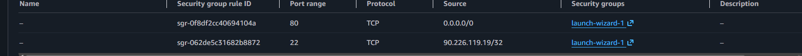

**Verifiering:** Instansen har status **Running** och **3/3 checks passed**.

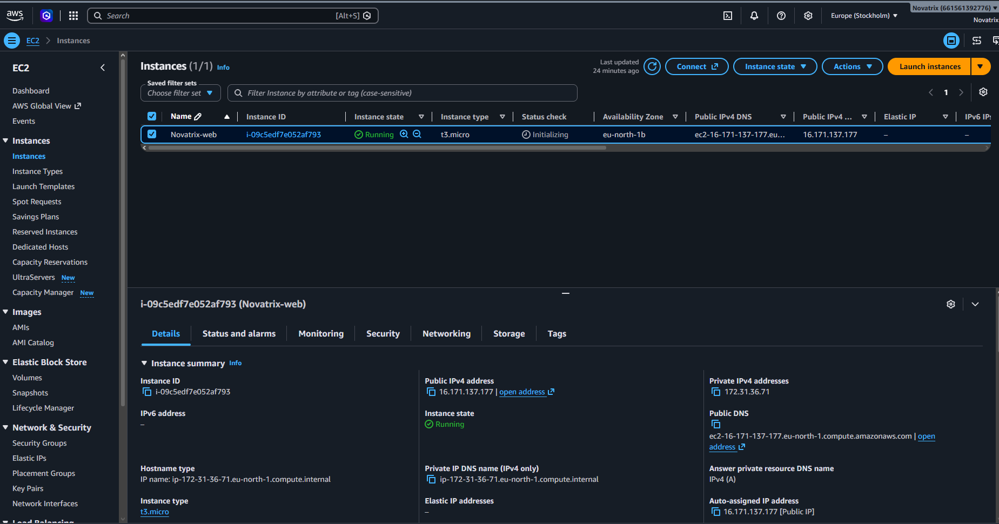

---

## Delmoment 3: SSH och webbserver

### Ansluta med SSH

Jag anslöt från terminalen i VS Code (PowerShell):

```powershell
ssh -i $HOME\.ssh\novatrix-key.pem ec2-user@16.171.137.177
```

- `-i` talar om vilken nyckel som ska användas.
- `ec2-user` är standardanvändaren på Amazon Linux.

Sen kollade jag vem jag var inloggad som:

```bash
whoami
```

Svaret blev `ec2-user`.

### Installera webbservern

```bash
# Uppdatera alla paket
sudo yum update -y

# Installera webbservern Apache (heter httpd på Amazon Linux)
sudo yum install httpd -y
```

- `sudo` behövs för att ändra i systemet.
- `-y` svarar ja automatiskt på alla frågor.

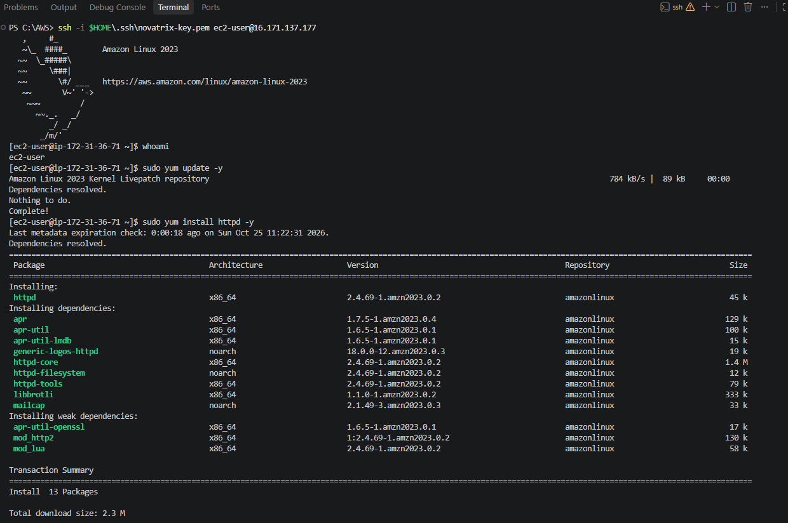

### Starta webbservern

```bash
# Kolla status (först var den avstängd)
sudo systemctl status httpd

# Starta webbservern nu
sudo systemctl start httpd

# Starta webbservern automatiskt när servern startar om
sudo systemctl enable httpd

# Kolla status igen
sudo systemctl status httpd
```

Först stod det `inactive (dead)` och `disabled`. Efter `start` och `enable` stod det `active (running)` och `enabled`.

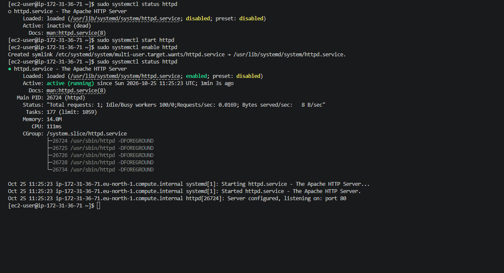

**Verifiering:** När jag surfade till `http://16.171.137.177` kom Apaches standardsida **"It works!"**. Då visste jag att httpd var igång och att port 80 var öppen.

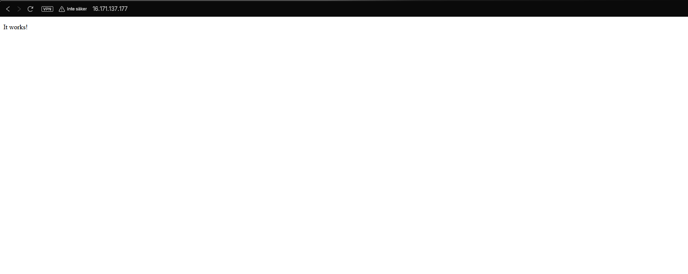

---

## Delmoment 4: Novatrix-sidan

Webbservern läser sina filer från mappen `/var/www/html`. Filen `index.html` visas automatiskt när man surfar till IP-adressen.

Jag skapade filen med nano:

```bash
sudo nano /var/www/html/index.html
```

- `sudo` behövs eftersom mappen ägs av root.
- Spara i nano: `Ctrl+O`, `Enter`, sen `Ctrl+X` för att stänga.

Det här är koden (samma fil finns i repot som `V42/index.html`):

```html
<!DOCTYPE html>
<html lang="sv">
<head>
  <meta charset="utf-8">
  <title>Novatrix AB</title>
  <style>
    body { font-family: Verdana, sans-serif; max-width: 600px; margin: 60px auto; padding: 0 20px; background: #FFF8D6; color: #261C33; }
    h1 { color: #5B3FA0; }
  </style>
</head>
<body>
  <h1>Novatrix AB</h1>
  <p>Vi är Novatrix kundtjänst. Skicka ett ärende till oss, så hjälper vi dig.</p>
  <p>Sidan körs på en server i AWS (EC2) i Stockholm.</p>
</body>
</html>
```

- `<meta charset="utf-8">` gör att å, ä och ö visas rätt.
- `<style>` ger sidan färger och en lagom bred textspalt.

Jag behövde inte starta om httpd. Webbservern läser filen på nytt varje gång någon besöker sidan.

---

## Delmoment 5: Verifiering

Jag surfade till `http://16.171.137.177` och Novatrix-sidan visades.

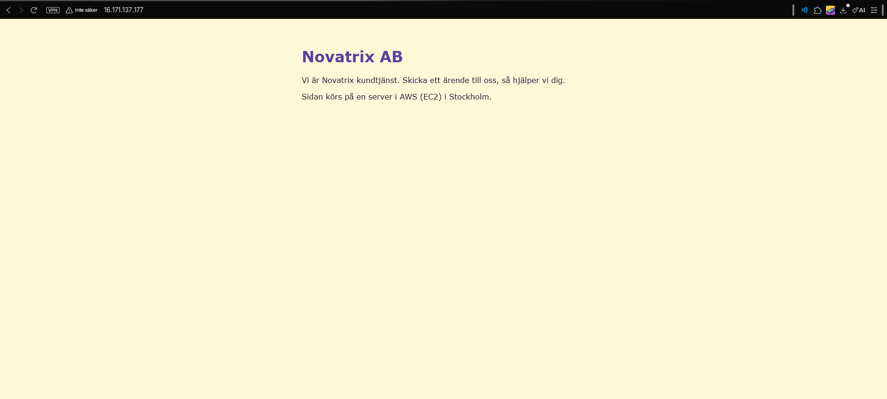

Sammanfattning av hur jag verifierade varje delmoment:

| Delmoment | Hur jag kollade | Resultat |
|---|---|---|
| 1. GitHub-repo | `git status` och GitHub i webbläsaren | Alla filer finns, ingen nyckel |
| 2. EC2-instans | EC2-konsolen | Running, 3/3 checks passed |
| 3. Webbserver | `sudo systemctl status httpd` | `active (running)` |
| 4. Novatrix-sidan | `http://16.171.137.177` i webbläsaren | Sidan visas |
| 6. Budget | AWS Budgets | Status OK, mejladresser verifierade |

Man kan också kontrollera sidan direkt från servern med `curl localhost`. Då skrivs HTML-koden ut i terminalen.

---

## Delmoment 6: Budget och kostnadskontroll

Jag satte upp en månadsbudget i **AWS Budgets**.

| Inställning | Värde |
|---|---|
| Namn | `My Monthly Cost Budget` |
| Belopp | 10 USD per månad |
| Larm 1 | Faktisk kostnad över 85 % |
| Larm 2 | Faktisk kostnad över 100 % |
| Larm 3 | Prognostiserad kostnad över 100 % |
| Mottagare | Min skolmejl och min privata mejl |

- **Faktisk kostnad** är vad jag redan har betalat för.
- **Prognostiserad kostnad** är vad AWS tror att månaden kommer kosta. Det larmet varnar **innan** pengarna är slut.
- Båda mejladresserna är **verifierade**. Annars kommer inga larm fram.

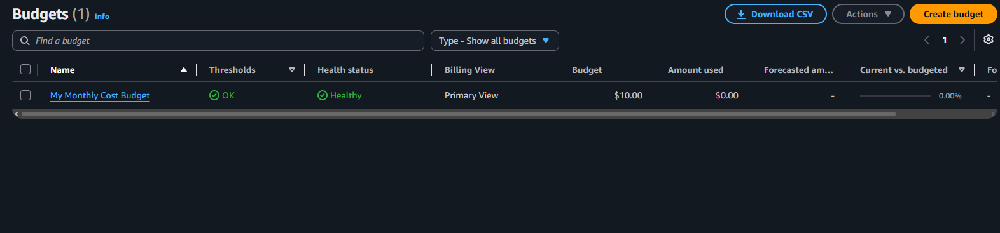

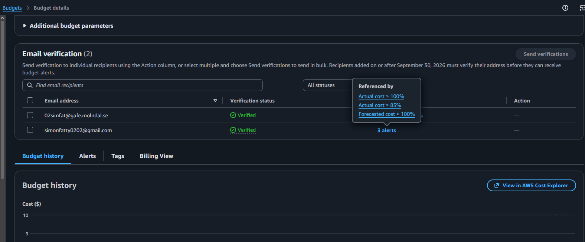

---

## VG: Hela miljön från kod

För G klickade jag fram instansen i konsolen och installerade allt för hand med SSH. För VG gör jag samma sak **från kod**. Då kan miljön skapas igen, likadan, med ett enda kommando.

Jag använder två verktyg tillsammans:

- **AWS CLI** skapar instansen från min dator, i stället för att jag klickar i konsolen.
- **User data** är ett skript som servern kör själv vid första starten. Det installerar webbservern och hämtar sidan. Jag behöver aldrig logga in med SSH.

### Hur filerna hänger ihop

```
deploy.ps1 (min dator)
   |  AWS CLI: "skapa en instans och skicka med user-data.sh"
   v
AWS skapar instansen Novatrix-web-cli
   |  servern startar för första gången
   v
user-data.sh körs på servern
   |  installerar httpd och startar den
   v
Hämtar index.html från mitt repo på GitHub
   |
   v
Sidan visas på den nya publika IP-adressen
```

| Fil | Var den körs | Vad den gör |
|---|---|---|
| `V42/deploy.ps1` | Min dator | Skapar instansen och skickar med user data |
| `V42/user-data.sh` | Servern | Installerar httpd och hämtar sidan från GitHub |
| `V42/destroy.ps1` | Min dator | Tar bort instansen igen |
| `.gitattributes` | Git | Ser till att `.sh`-filer alltid har Linux-radslut |

### Förberedelser: AWS CLI och inloggning

AWS CLI fanns inte på min dator. Jag installerade det med winget:

```powershell
winget install -e --id Amazon.AWSCLI
aws --version
```

**Problem:** Första gången fick jag felet `The term 'aws' is not recognized`. Terminalen hittade inte programmet.

**Lösning:** Windows sparar var program finns i en lista som heter `PATH`. VS Code läser den bara när det startar. Efter installationen startade jag om VS Code, och då fungerade det (`aws-cli/2.38.5`).

Sen loggade jag in:

```powershell
aws configure set region eu-north-1
aws login
aws sts get-caller-identity
```

- `aws configure set region` sparar Stockholm som standardregion.
- `aws login` öppnar webbläsaren, där jag loggar in som vanligt. CLI:n får en tillfällig inloggning, max 12 timmar. **Inga fasta nycklar sparas på datorn.**
- `aws sts get-caller-identity` visar vilket konto jag är inloggad på (`661561392776`).

Just nu loggar jag in som root. I V43 (IAM) byter jag till en egen IAM-användare.

### user-data.sh

```bash
#!/bin/bash
# user-data.sh (V42, VG)
# Det här skriptet körs av SERVERN själv, en gång, vid första starten.
# Det körs som root, så sudo behövs inte.
# Loggen hamnar på servern i /var/log/cloud-init-output.log

# -e: stoppa direkt om ett kommando misslyckas
# -x: skriv ut varje kommando i loggen, så det är lätt att felsöka
set -ex

# 1. Uppdatera paketen och installera webbservern Apache (httpd)
yum update -y
yum install -y httpd

# 2. Starta httpd nu (--now) och automatiskt efter omstart (enable)
systemctl enable --now httpd

# 3. Hämta Novatrix-sidan från mitt repo på GitHub
#    -f  avbryt om sidan inte finns (sparar inte en felsida)
#    -sS tyst, men visa fel
#    -L  följ vidarekopplingar
#    -o  spara som index.html i webbmappen
curl -fsSL https://raw.githubusercontent.com/02simfat/AWS-MOV25/main/V42/index.html -o /var/www/html/index.html
```

- Det är **samma steg som jag gjorde för hand** i Delmoment 3 och 4, fast i ett skript.
- `sudo` behövs inte, eftersom user data körs som root.
- Sidan hämtas från repot. Då finns `index.html` på **ett** ställe, och servern får alltid den senaste versionen.

### deploy.ps1

```powershell
# deploy.ps1 (V42, VG)
# Skapar Novatrix webbserver i AWS från kod.
# Kör från terminalen i VS Code:  .\deploy.ps1
# Krav: AWS CLI är installerat och du är inloggad med "aws login".

# ---------- Inställningar: byt här om miljön är en annan ----------
$Region        = "eu-north-1"            # Europe (Stockholm)
$Name          = "Novatrix-web-cli"      # Eget namn, så destroy.ps1 inte rör Novatrix-web
$InstanceType  = "t3.micro"              # Free tier
$KeyName       = "novatrix-key"          # Key pair som redan finns i AWS
$SecurityGroup = "sg-0c5e9571d95eecce7"  # launch-wizard-1 (port 22 och 80)
$UserData      = "$PSScriptRoot\user-data.sh"

# Senaste Amazon Linux 2023. AWS slår upp rätt AMI-id själv, så det blir aldrig gammalt.
$Ami = "resolve:ssm:/aws/service/ami-amazon-linux-latest/al2023-ami-kernel-default-x86_64"

# ---------- 1. Kolla inloggningen ----------
Write-Host "1/4 Kollar att du är inloggad i AWS..."
aws sts get-caller-identity --query Account --output text
if ($LASTEXITCODE -ne 0) { Write-Host "Du är inte inloggad. Kör: aws login"; exit 1 }

# ---------- 2. Starta instansen ----------
Write-Host "2/4 Startar instansen $Name..."
$InstanceId = aws ec2 run-instances `
    --region $Region `
    --image-id $Ami `
    --instance-type $InstanceType `
    --key-name $KeyName `
    --security-group-ids $SecurityGroup `
    --user-data "file://$UserData" `
    --tag-specifications "ResourceType=instance,Tags=[{Key=Name,Value=$Name},{Key=Project,Value=Novatrix}]" `
    --query "Instances[0].InstanceId" `
    --output text
if ($LASTEXITCODE -ne 0) { Write-Host "Kunde inte starta instansen. Läs felet ovanför."; exit 1 }
Write-Host "    Instans-ID: $InstanceId"

# ---------- 3. Vänta tills den är igång ----------
Write-Host "3/4 Väntar tills instansen är Running (ca 1 minut)..."
aws ec2 wait instance-running --region $Region --instance-ids $InstanceId

# ---------- 4. Hämta den publika IP-adressen ----------
$PublicIp = aws ec2 describe-instances `
    --region $Region `
    --instance-ids $InstanceId `
    --query "Reservations[0].Instances[0].PublicIpAddress" `
    --output text

Write-Host "4/4 Klart!"
Write-Host "    Publik IP: $PublicIp"
Write-Host "    Vänta 1-2 minuter medan user data installerar webbservern."
Write-Host "    Öppna sedan: http://$PublicIp"
```

Det viktigaste i skriptet:

- **Alla inställningar står överst.** Ska miljön byggas i ett annat konto byter man bara där.
- **`resolve:ssm:...`** låter AWS slå upp senaste Amazon Linux 2023. Ett hårdkodat AMI-id blir gammalt, det här blir det aldrig.
- **`--user-data "file://..."`** skickar med `user-data.sh` till servern.
- **`--tag-specifications`** ger instansen namnet `Novatrix-web-cli` och taggen `Project=Novatrix`. Eget namn gör att `destroy.ps1` aldrig rör min vanliga `Novatrix-web`.
- **`--query` och `--output text`** plockar ut bara det jag behöver, till exempel instans-ID:t.
- **`$LASTEXITCODE`** är felkoden från senaste kommandot. Är den inte 0 har något gått fel, och skriptet stoppar.
- **`aws ec2 wait instance-running`** väntar tills instansen är igång innan skriptet hämtar IP-adressen.

### destroy.ps1

```powershell
# destroy.ps1 (V42, VG)
# Tar bort instansen som deploy.ps1 skapade.
# Kör från terminalen i VS Code:  .\destroy.ps1
# Rör bara instanser som heter Novatrix-web-cli, inte din vanliga Novatrix-web.

$Region = "eu-north-1"
$Name   = "Novatrix-web-cli"

# ---------- 1. Hitta instansen ----------
# Letar efter instanser med rätt namn som inte redan är borttagna
$Ids = aws ec2 describe-instances `
    --region $Region `
    --filters "Name=tag:Name,Values=$Name" "Name=instance-state-name,Values=pending,running,stopping,stopped" `
    --query "Reservations[].Instances[].InstanceId" `
    --output text

if (-not $Ids) { Write-Host "Hittade ingen instans som heter $Name. Inget att ta bort."; exit 0 }

# Om det finns flera blir det en lista
$IdList = $Ids -split "\s+"
Write-Host "Hittade: $IdList"

# ---------- 2. Fråga först ----------
$Svar = Read-Host "Vill du ta bort den? Skriv ja"
if ($Svar -ne "ja") { Write-Host "Avbrutet. Inget togs bort."; exit 0 }

# ---------- 3. Ta bort och vänta ----------
aws ec2 terminate-instances --region $Region --instance-ids $IdList --output text | Out-Null
Write-Host "Tar bort... (ca 1 minut)"
aws ec2 wait instance-terminated --region $Region --instance-ids $IdList
Write-Host "Klart! $Name är borttagen."
```

- **`--filters`** letar bara efter instanser med namnet `Novatrix-web-cli` som inte redan är borttagna.
- **`Read-Host`** frågar innan något tas bort. Terminate går inte att ångra.
- **`aws ec2 wait instance-terminated`** väntar tills instansen verkligen är borta.

### .gitattributes

```
*.sh text eol=lf
```

Windows använder radslutet `CRLF`, Linux använder `LF`. Får ett bash-skript Windows-radslut kraschar det på servern. Den här raden gör att git alltid sparar `.sh`-filer med `LF`.

### Verifiering (VG)

**1. Deploy.** Jag körde `.\deploy.ps1`. Skriptet skapade en ny instans och skrev ut den nya IP-adressen `13.60.167.129`.

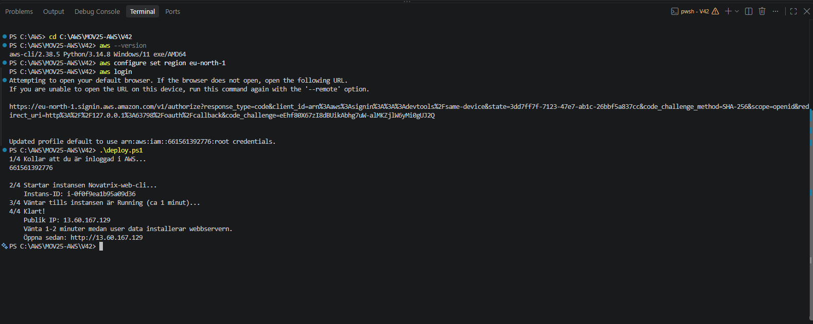

I EC2-konsolen syns `Novatrix-web-cli` som **Running**, bredvid min vanliga `Novatrix-web` som är stoppad.

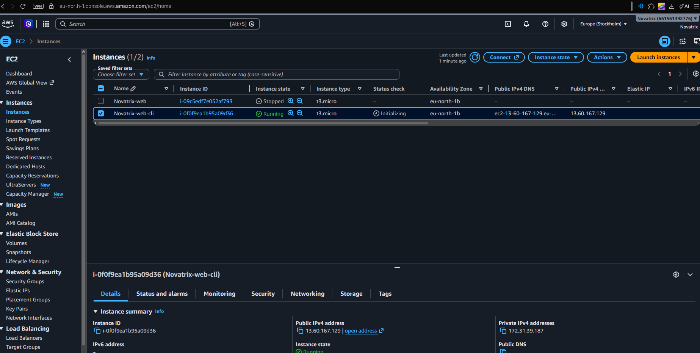

Efter ett par minuter surfade jag till `http://13.60.167.129`. Novatrix-sidan visades, **utan att jag hade loggat in med SSH**. User data hade alltså installerat httpd och hämtat sidan själv.

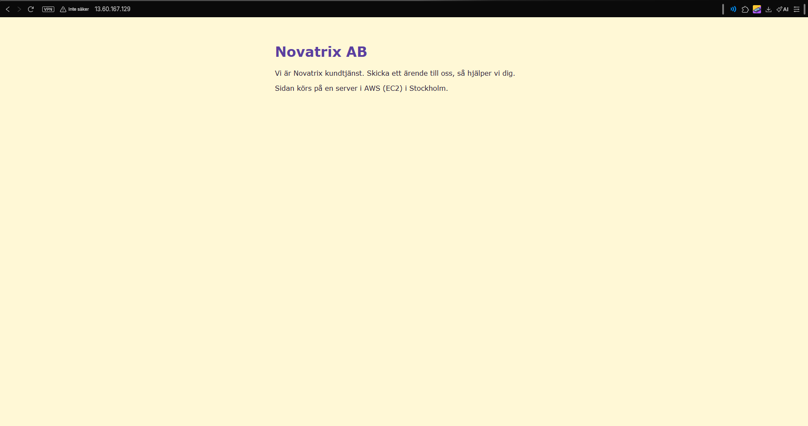

**2. Destroy.** Jag körde `.\destroy.ps1` och svarade `ja`.

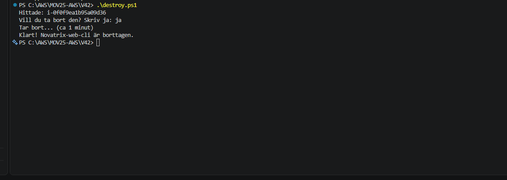

`Novatrix-web-cli` är **Terminated**. `Novatrix-web` är orörd.

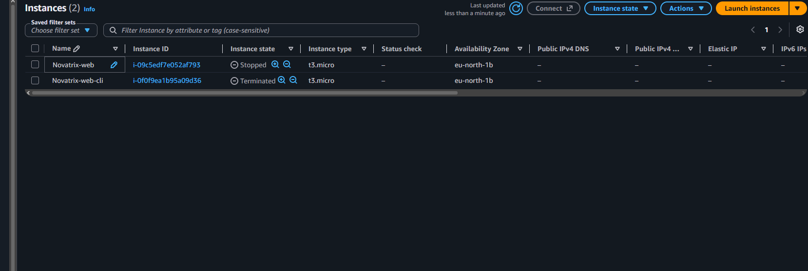

### Så återskapar du miljön från repot

1. Klona repot:
   ```powershell
   git clone https://github.com/02simfat/AWS-MOV25.git
   cd AWS-MOV25\V42
   ```
2. Installera AWS CLI och logga in:
   ```powershell
   winget install -e --id Amazon.AWSCLI
   aws configure set region eu-north-1
   aws login
   ```
3. Byt värdena i tabellen nedan om du använder ett annat konto.
4. Skapa miljön:
   ```powershell
   .\deploy.ps1
   ```
5. Vänta 1–2 minuter och öppna `http://<publik IP>` som skriptet skriver ut.
6. Ta bort miljön när du är klar:
   ```powershell
   .\destroy.ps1
   ```

**Värden som måste bytas i en annan miljö:**

| Värde | Fil | Varför |
|---|---|---|
| `$Region` | `deploy.ps1` och `destroy.ps1` | Om miljön ska ligga i en annan region |
| `$KeyName` | `deploy.ps1` | Key pair finns bara i det konto och den region där det skapades |
| `$SecurityGroup` | `deploy.ps1` | Security group-id är unikt per konto. Gruppen måste ha port 80 öppen (och 22 för SSH) |
| Länken i `curl` | `user-data.sh` | Om sidan ligger i ett annat repo |

Det här är första steget mot infrastruktur som kod. I V46 beskriver jag hela miljön i en CloudFormation-mall i stället.

---

## Säkerhet

- **MFA** är aktiverat på root-kontot.
- **SSH-nyckeln** ligger bara på min dator, i mappen `.ssh`. Den stoppas från repot av `.gitignore`.
- **Port 22** är bara öppen för min IP-adress.
- **Port 80** är öppen för alla, eftersom webbsidan ska kunna besökas.
- **AWS CLI** loggar in med `aws login`. Inga fasta nycklar sparas på datorn eller i repot.
- Sidan använder **http**, inte https. Det finns inget certifikat än.

## Städning

- Instansen kostar så länge den körs. När jag inte jobbar **stoppar** jag `Novatrix-web` (Stop, inte Terminate), eftersom vi bygger vidare på den nästa vecka.
- `Novatrix-web-cli` från VG-delen är **borttagen** med `destroy.ps1`. Den kan skapas igen när som helst med `deploy.ps1`.
- Den publika IP-adressen **byts** när en instans stoppas och startas igen. Då måste jag använda den nya adressen.
- Om jag byter nätverk måste jag uppdatera SSH-regeln till min nya IP-adress.
