# AWS - Uppgift 2 (V43)

**IAM och identitet**

- **Namn:** Simon Fatty
- **Kurs:** Amazon Web Services, MOV25
- **Repo:** https://github.com/02simfat/AWS-MOV25 (dokumentationen ligger i mappen `V43`)
- **Datum:** 2026-10-26

## Sammanfattning

Novatrix har nu tre sorters identiteter i AWS:

- **Människor i grupper:** `dev-erik` i gruppen **Utveckling** får bara läsa i S3. `Ops-anna` i gruppen **drift** får hantera filer i S3.
- **En adminanvändare:** `Simon-admin` med MFA. Root används inte längre till vardags.
- **En roll för en tjänst:** `Novatrix-ec2-S3-Read` låter webbservern `Novatrix-web` **läsa** från bucketen `novatrix-bucket-01`, utan nycklar på servern.

## Innehåll

1. Syfte
2. Novatrix roller (planen)
3. Delmoment 1: Repo
4. Förberedelse: adminanvändare
5. Delmoment 2: Användare och grupper
6. Delmoment 3: Policies enligt least privilege
7. Delmoment 4: Behörigheter mellan tjänster
8. Delmoment 5: Verifiering
9. Säkerhet
10. Förbättringar (inför VG)
11. Städning

---

## Syfte

Novatrix behöver styra **vem** som får göra **vad** i AWS. Det gäller både människor och tjänster.

Jag följer **least privilege**: varje användare och tjänst får precis den åtkomst den behöver, inte mer. Det skyddar mot både misstag och intrång.

Veckans kärna är **behörighet mellan tjänster**: webbservern (EC2) ska få läsa filer från lagringen (S3).

## Novatrix roller (planen)

Innan jag klickade i konsolen skrev jag ner vad varje roll behöver.

| Vem | Typ | Behöver | Policy |
|---|---|---|---|
| `Simon-admin` | Användare | Administrera hela kontot | `AdministratorAccess` |
| `dev-erik` | Användare i gruppen **Utveckling** | Läsa filer i S3 | `AmazonS3ReadOnlyAccess` (via gruppen) |
| `Ops-anna` | Användare i gruppen **drift** | Ladda upp och hantera filer i S3 | `AmazonS3FullAccess` (via gruppen) |
| `Novatrix-web` | EC2-instans med rollen `Novatrix-ec2-S3-Read` | Läsa filer i bucketen | `AmazonS3ReadOnlyAccess` |

```
Människor                                    Tjänster

dev-erik  --> grupp Utveckling --> S3: bara läsa
Ops-anna  --> grupp drift      --> S3: läsa och skriva

Novatrix-web (EC2) --> roll Novatrix-ec2-S3-Read --> novatrix-bucket-01: bara läsa
```

---

## Delmoment 1: Repo

Mappen `V43` finns i kursrepot, med en egen README och mappen `Bilder-v43`. README i roten listar V43.

```
AWS-MOV25/
├── README.md
├── V42/
├── V43/
│   ├── README.md      (den här redovisningen)
│   └── Bilder-v43/    (skärmbilder)
...
```

---

## Förberedelse: adminanvändare

Förra veckan loggade jag in som **root**. Root kan göra allt i kontot och går inte att begränsa. Därför ska root inte användas till vardags.

Jag skapade adminanvändaren `Simon-admin`:

- **Konsolåtkomst** med lösenord
- **MFA** med en autentiseringsapp
- Policyn `AdministratorAccess`, så att jag kan bygga i kontot

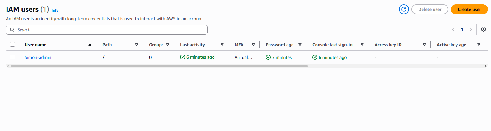

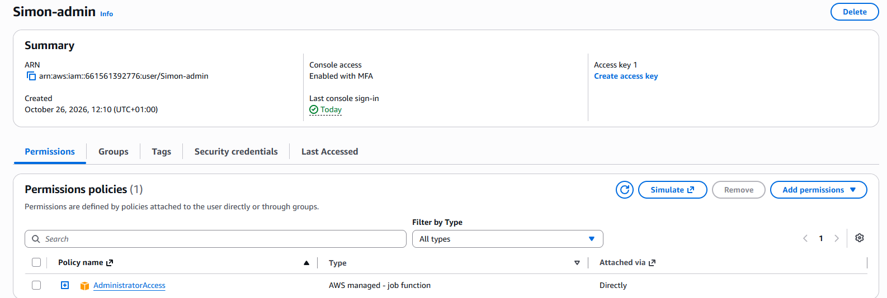

Nu loggar jag in som `Simon-admin` via kontots inloggnings-URL. Root har också MFA och används bara om det verkligen behövs.

---

## Delmoment 2: Användare och grupper

Jag skapade en **grupp per roll** och la användarna direkt i rätt grupp.

| Grupp | Användare | Konsolåtkomst |
|---|---|---|
| **Utveckling** | `dev-erik` | Ja |
| **drift** | `Ops-anna` | Ja |

**Varför grupper?** Policyn kopplas en gång till gruppen, inte till varje person. Börjar en ny utvecklare läggs hen bara i gruppen och får rätt behörighet direkt. Det gör behörigheterna lätta att överblicka.


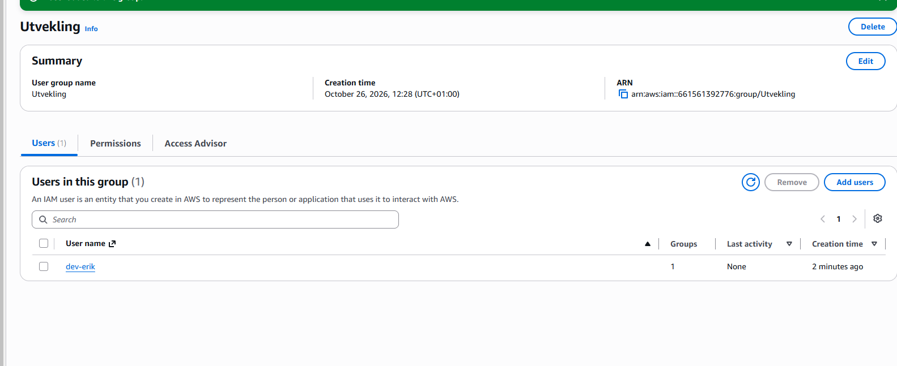

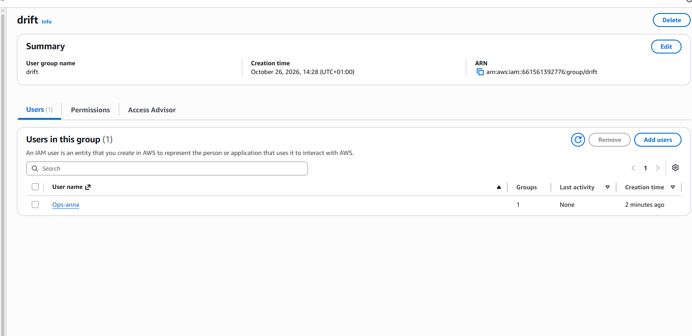

---

## Delmoment 3: Policies enligt least privilege

En **policy** är ett JSON-dokument som säger vad som är tillåtet. Den har tre viktiga delar:

- **Effect:** `Allow` (tillåt) eller `Deny` (neka)
- **Action:** vad man får göra, till exempel `s3:GetObject` (läsa en fil)
- **Resource:** vilka resurser det gäller. `*` betyder alla.

### Utveckling: AmazonS3ReadOnlyAccess

Utvecklarna behöver **läsa** filer i S3, men ska inte kunna ändra eller radera något.

```json
{
  "Version": "2012-10-17",
  "Statement": [
    {
      "Effect": "Allow",
      "Action": [
        "s3:Get*",
        "s3:List*",
        "s3:Describe*",
        "s3-object-lambda:Get*",
        "s3-object-lambda:List*"
      ],
      "Resource": "*"
    }
  ]
}
```

- `Get*`, `List*` och `Describe*` är bara läs-actions. Det finns ingen `Put` (ladda upp) eller `Delete` (radera).
- En utvecklare kan alltså inte råka radera Novatrix filer.

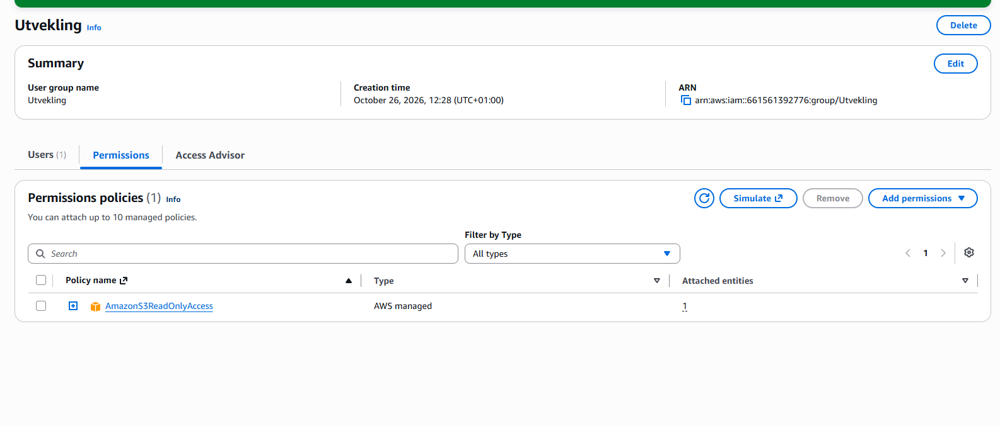

### drift: AmazonS3FullAccess

Drift sköter driften och behöver kunna **ladda upp och hantera** filer i S3.

```json
{
  "Version": "2012-10-17",
  "Statement": [
    {
      "Effect": "Allow",
      "Action": [
        "s3:*",
        "s3-object-lambda:*"
      ],
      "Resource": "*"
    }
  ]
}
```

- `s3:*` betyder **alla** S3-actions, och `"Resource": "*"` betyder **alla** buckets.
- Drift får alltså mer än gruppen Utveckling, vilket stämmer med att drift har mer ansvar.

**Min egen granskning:** Den här policyn är **för bred** för least privilege. Med `s3:*` på `*` kan drift radera **alla** buckets i kontot och ändra deras behörigheter. Det behöver drift inte. Jag beskriver hur jag vill förbättra den under *Förbättringar (inför VG)*.

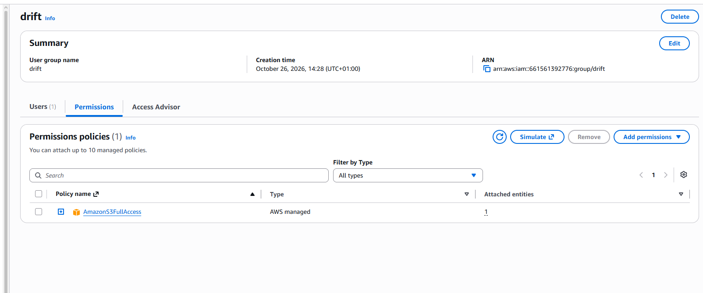

---

## Delmoment 4: Behörigheter mellan tjänster

Det här är veckans kärna: webbservern ska få läsa från S3, **utan att jag lägger nycklar på servern**.

### Steg 1: Bucketen

Jag skapade bucketen `novatrix-bucket-01` i Stockholm och la in testfilen `Text.Bucket.txt`. Bucketen är **privat**: *Block all public access* är påslaget.

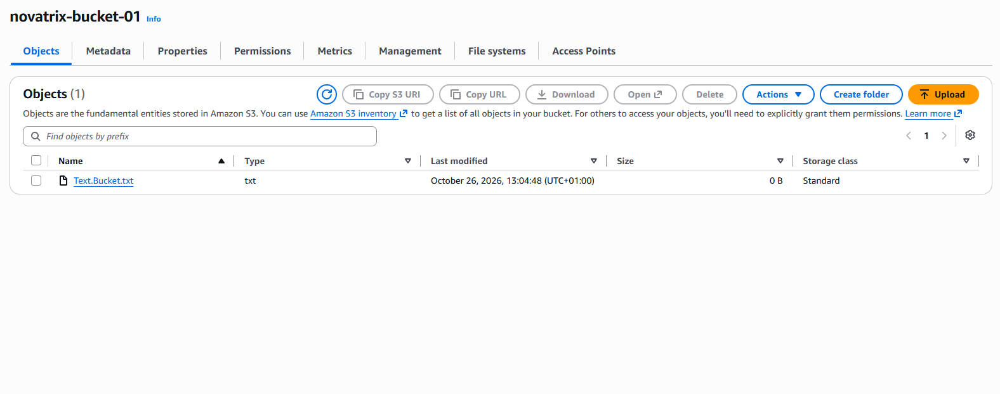

### Steg 2: Rollen

Jag skapade rollen `Novatrix-ec2-S3-Read` under **IAM > Roles > Create role**:

- **Trusted entity:** AWS service, EC2
- **Behörighet:** `AmazonS3ReadOnlyAccess`

En roll har **två** policies, och de svarar på olika frågor:

| Policy | Frågan den svarar på | I min roll |
|---|---|---|
| **Trust policy** | **Vem** får anta rollen? | Tjänsten EC2 |
| **Behörighetspolicy** | **Vad** får rollen göra? | Läsa i S3 |

Trust policyn som konsolen skapade:

```json
{
  "Version": "2012-10-17",
  "Statement": [
    {
      "Effect": "Allow",
      "Action": [
        "sts:AssumeRole"
      ],
      "Principal": {
        "Service": [
          "ec2.amazonaws.com"
        ]
      }
    }
  ]
}
```

- `"Principal": { "Service": "ec2.amazonaws.com" }` betyder att bara tjänsten EC2 får använda rollen.
- `sts:AssumeRole` betyder "anta rollen". EC2 får alltså låna rollens behörigheter.
- Behörighetspolicyn är samma `AmazonS3ReadOnlyAccess` som under Delmoment 3.

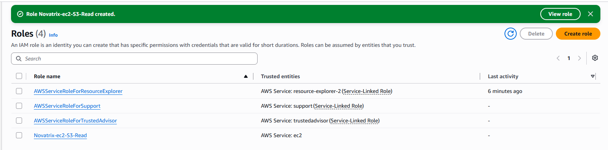

### Steg 3: Koppla rollen till servern

I EC2-konsolen markerade jag `Novatrix-web` och valde **Actions > Security > Modify IAM role**. Där valde jag `Novatrix-ec2-S3-Read` och sparade.

Konsolen skapar då en **instance profile** automatiskt. Det är "behållaren" som gör att en EC2-instans kan bära en roll.

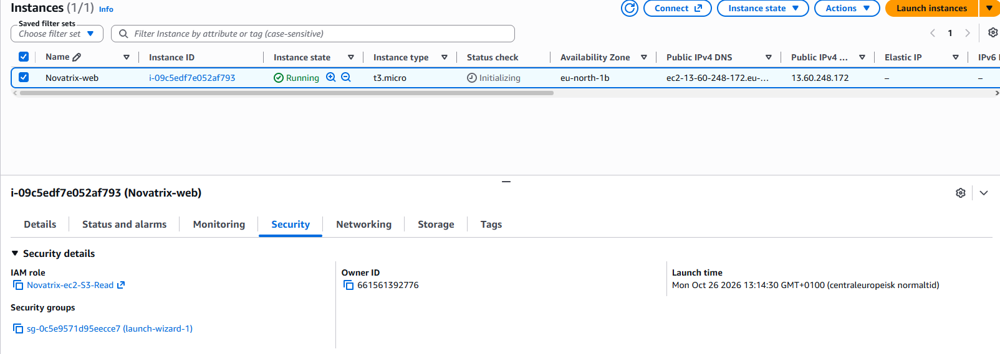

**Varför en roll och inte nycklar?** Rollen ger servern **tillfälliga** nycklar som byts ut automatiskt. Det finns inga fasta nycklar på servern som kan läcka eller hamna på GitHub.

---

## Delmoment 5: Verifiering

Jag testade både det som **ska fungera** och det som **ska nekas**. Access Denied på rätt ställe visar att least privilege faktiskt gäller.

### Test 1: Servern får läsa (ska fungera)

Jag anslöt till servern med SSH:

```powershell
ssh -i $HOME\.ssh\novatrix-key.pem ec2-user@13.60.248.172
```

Och listade bucketen:

```bash
aws s3 ls s3://novatrix-bucket-01
```

Resultat:

```
2026-10-26 12:04:48          0 Text.Bucket.txt
```

Servern kan läsa bucketen, fast jag aldrig har lagt in några nycklar. **Rollen fungerar.**

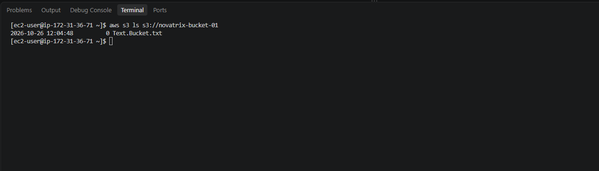

### Test 2: Servern får inte skriva (ska nekas)

```bash
echo "test" > test.txt
aws s3 cp test.txt s3://novatrix-bucket-01/
```

Resultat:

```
upload failed: ./test.txt to s3://novatrix-bucket-01/test.txt An error occurred (AccessDenied) when calling the PutObject operation: User: arn:aws:sts::661561392776:assumed-role/Novatrix-ec2-S3-Read/i-09c5edf7e052af793 is not authorized to perform: s3:PutObject on resource: "arn:aws:s3:::novatrix-bucket-01/test.txt" because no identity-based policy allows the s3:PutObject action
```

Så läser jag felet:

- `PutObject` är AWS-namnet för "ladda upp en fil".
- `assumed-role/Novatrix-ec2-S3-Read` visar att servern använder rollen.
- `no identity-based policy allows the s3:PutObject action` betyder att rollen saknar skrivrätt. Precis som det ska vara.

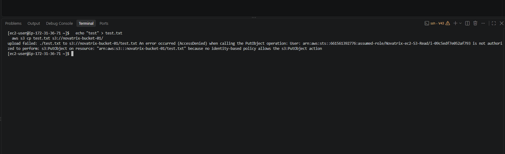

### Test 3: Ops-anna (drift) laddar upp en fil (ska fungera)

Jag loggade in som `Ops-anna` i ett privat webbläsarfönster och laddade upp `ops-anna-test.txt` till bucketen. **Upload succeeded.**

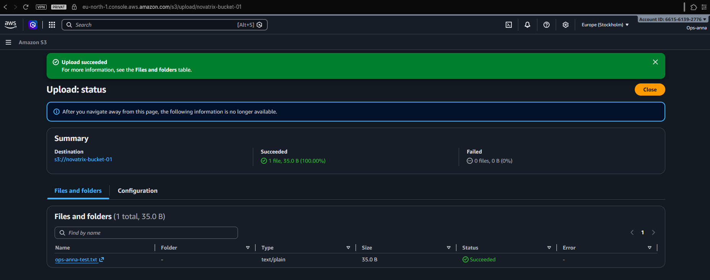

### Test 4: dev-erik (utveckling) laddar upp en fil (ska nekas)

Jag loggade in som `dev-erik` och försökte ladda upp `Dev-erik-test.txt`. **Upload failed** med **Access denied**.

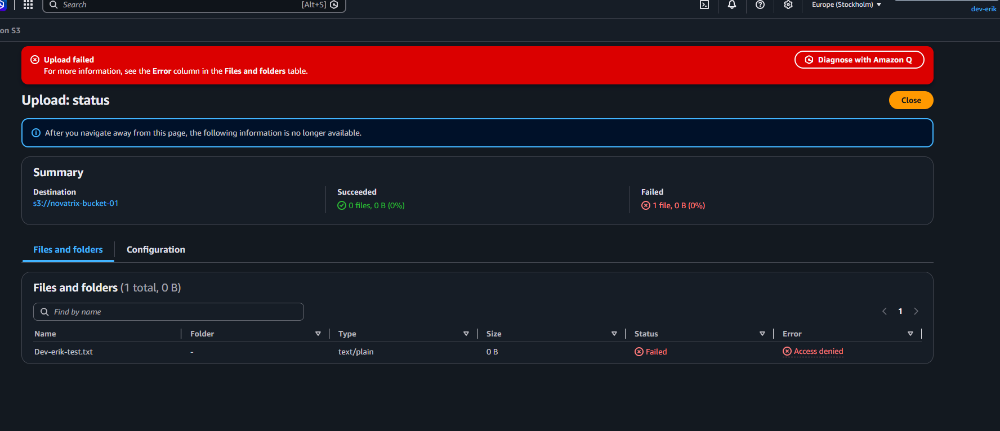

### Sammanfattning av testerna

| Test | Vem | Förväntat | Resultat |
|---|---|---|---|
| Lista bucketen | Servern (rollen) | Tillåts | ✅ Tillåts |
| Ladda upp fil | Servern (rollen) | Nekas | ✅ Nekas |
| Ladda upp fil | `Ops-anna` (drift) | Tillåts | ✅ Tillåts |
| Ladda upp fil | `dev-erik` (Utveckling) | Nekas | ✅ Nekas |

Alla fyra tester blev som förväntat. Behörigheterna fungerar som jag planerade.

---

## Säkerhet

- **Root** används inte längre. Jag loggar in som `Simon-admin`. Både root och admin har MFA.
- **Behörighet via grupp**, aldrig direkt på en person.
- **Inga nycklar på servern.** Rollen ger tillfälliga nycklar.
- **Bucketen är privat.** *Block all public access* är på.
- **Inga lösenord, inloggnings-URL:er eller CSV-filer från IAM** ligger i repot.

## Förbättringar (inför VG)

Två policies är bredare än de behöver vara:

| Vad | Problem | Förbättring |
|---|---|---|
| drift: `AmazonS3FullAccess` | `s3:*` på alla buckets. Drift kan radera alla buckets i kontot. | Egen policy: bara `novatrix-bucket-01`, ingen radering av buckets. |
| Utveckling och rollen: `AmazonS3ReadOnlyAccess` | `"Resource": "*"` ger läsrätt i **alla** buckets, inte bara Novatrix. | Egen policy som bara gäller `novatrix-bucket-01`. |

Det gör jag i VG-delen, med egna JSON-policies som skapas från kod.

## Städning

- Jag **stoppar** `Novatrix-web` när jag är klar för dagen.
- Jag **behåller** rollen `Novatrix-ec2-S3-Read` och bucketen `novatrix-bucket-01`. Vi bygger vidare på dem kommande veckor.
- IAM kostar inget, men jag tar bort testanvändare som inte behövs längre.
