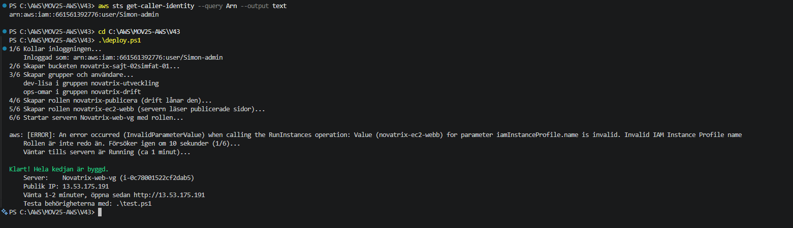
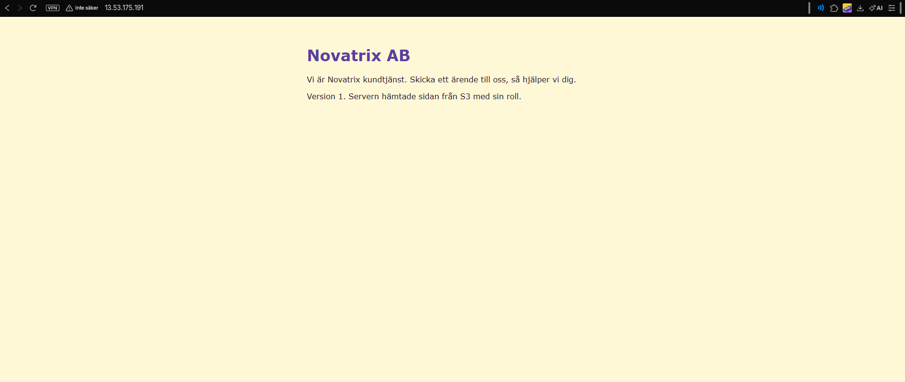
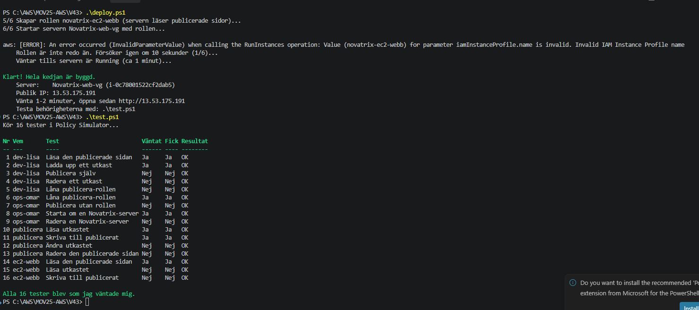
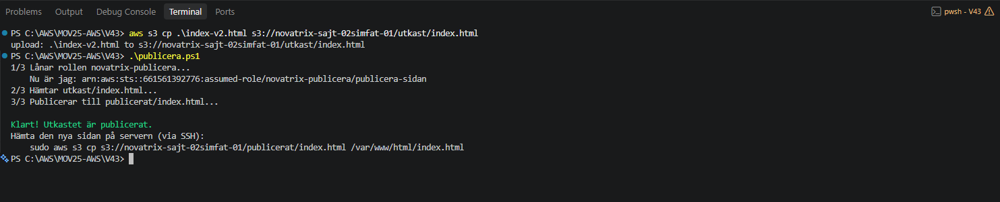
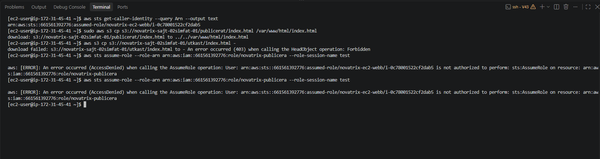
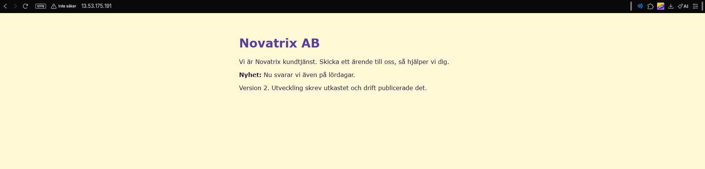
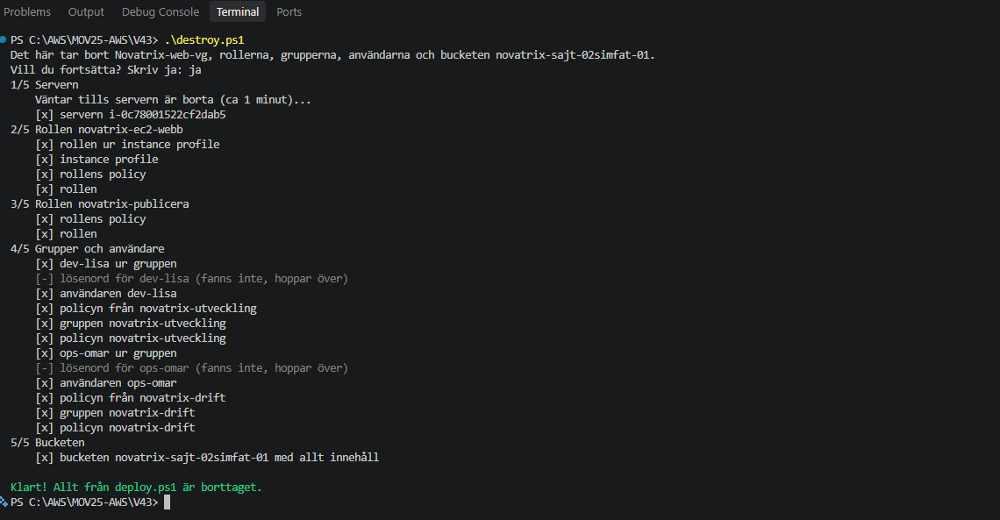
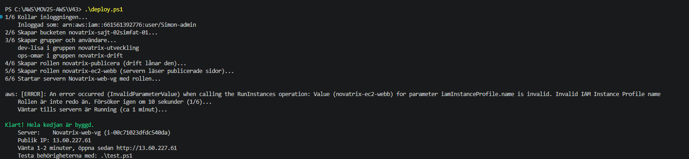
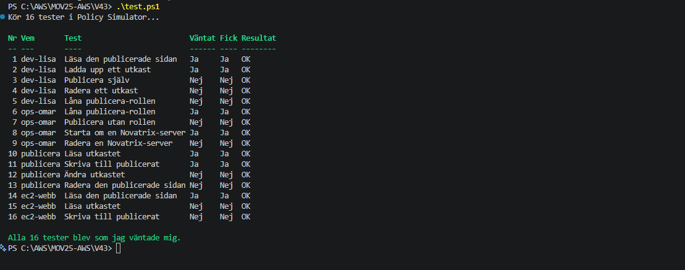

# AWS - Uppgift 2 (V43)

**IAM och identitet**

- **Namn:** Simon Fatty
- **Kurs:** Amazon Web Services, MOV25
- **Repo:** https://github.com/02simfat/AWS-MOV25 (dokumentationen ligger i mappen `V43`)
- **Datum:** 2026-10-26

## Sammanfattning

Novatrix har nu tre sorters identiteter i AWS:

- **Människor i grupper:** `dev-erik` i gruppen **Utveckling** får bara läsa i S3. `Ops-anna` i gruppen **drift** får hantera filer i S3.
- **En adminanvändare:** `Simon-admin` med MFA. Root används inte längre till vardags.
- **En roll för en tjänst:** `Novatrix-ec2-S3-Read` låter webbservern `Novatrix-web` **läsa** från bucketen `novatrix-bucket-01`, utan nycklar på servern.

**VG:** En publiceringskedja byggd från kod. Utveckling lämnar ett utkast, drift lånar en roll och publicerar, och servern visar sidan. Ingen kan publicera ensam, och allt byggs och rivs med två skript.

## Innehåll

1. Syfte
2. Novatrix roller (planen)
3. Delmoment 1: Repo
4. Förberedelse: adminanvändare
5. Delmoment 2: Användare och grupper
6. Delmoment 3: Policies enligt least privilege
7. Delmoment 4: Behörigheter mellan tjänster
8. Delmoment 5: Verifiering
9. VG: Publiceringskedjan
10. Säkerhet
11. Städning
12. Bilaga: policyerna (VG)

---

## Syfte

Novatrix behöver styra **vem** som får göra **vad** i AWS. Det gäller både människor och tjänster.

Jag följer **least privilege**: varje användare och tjänst får precis den åtkomst den behöver, inte mer. Det skyddar mot både misstag och intrång.

Veckans kärna är **behörighet mellan tjänster**: webbservern (EC2) ska få läsa filer från lagringen (S3).

## Novatrix roller (planen)

Innan jag klickade i konsolen skrev jag ner vad varje roll behöver.

| Vem | Typ | Behöver | Policy |
|---|---|---|---|
| `Simon-admin` | Användare | Administrera hela kontot | `AdministratorAccess` |
| `dev-erik` | Användare i gruppen **Utveckling** | Läsa filer i S3 | `AmazonS3ReadOnlyAccess` (via gruppen) |
| `Ops-anna` | Användare i gruppen **drift** | Ladda upp och hantera filer i S3 | `AmazonS3FullAccess` (via gruppen) |
| `Novatrix-web` | EC2-instans med rollen `Novatrix-ec2-S3-Read` | Läsa filer i bucketen | `AmazonS3ReadOnlyAccess` |

```
Människor                                    Tjänster

dev-erik  --> grupp Utveckling --> S3: bara läsa
Ops-anna  --> grupp drift      --> S3: läsa och skriva

Novatrix-web (EC2) --> roll Novatrix-ec2-S3-Read --> novatrix-bucket-01: bara läsa
```

---

## Delmoment 1: Repo

Mappen `V43` finns i kursrepot, med en egen README och mappen `Bilder-v43`. README i roten listar V43.

```
AWS-MOV25/
├── README.md
├── V42/
├── V43/
│   ├── README.md      (den här redovisningen)
│   └── Bilder-v43/    (skärmbilder)
...
```

---

## Förberedelse: adminanvändare

Förra veckan loggade jag in som **root**. Root kan göra allt i kontot och går inte att begränsa. Därför ska root inte användas till vardags.

Jag skapade adminanvändaren `Simon-admin`:

- **Konsolåtkomst** med lösenord
- **MFA** med en autentiseringsapp
- Policyn `AdministratorAccess`, så att jag kan bygga i kontot


Nu loggar jag in som `Simon-admin` via kontots inloggnings-URL. Root har också MFA och används bara om det verkligen behövs.

---

## Delmoment 2: Användare och grupper

Jag skapade en **grupp per roll** och la användarna direkt i rätt grupp.

| Grupp | Användare | Konsolåtkomst |
|---|---|---|
| **Utveckling** | `dev-erik` | Ja |
| **drift** | `Ops-anna` | Ja |

**Varför grupper?** Policyn kopplas en gång till gruppen, inte till varje person. Börjar en ny utvecklare läggs hen bara i gruppen och får rätt behörighet direkt. Det gör behörigheterna lätta att överblicka.


---

## Delmoment 3: Policies enligt least privilege

En **policy** är ett JSON-dokument som säger vad som är tillåtet. Den har tre viktiga delar:

- **Effect:** `Allow` (tillåt) eller `Deny` (neka)
- **Action:** vad man får göra, till exempel `s3:GetObject` (läsa en fil)
- **Resource:** vilka resurser det gäller. `*` betyder alla.

### Utveckling: AmazonS3ReadOnlyAccess

Utvecklarna behöver **läsa** filer i S3, men ska inte kunna ändra eller radera något.

```json
{
  "Version": "2012-10-17",
  "Statement": [
    {
      "Effect": "Allow",
      "Action": [
        "s3:Get*",
        "s3:List*",
        "s3:Describe*",
        "s3-object-lambda:Get*",
        "s3-object-lambda:List*"
      ],
      "Resource": "*"
    }
  ]
}
```

- `Get*`, `List*` och `Describe*` är bara läs-actions. Det finns ingen `Put` (ladda upp) eller `Delete` (radera).
- En utvecklare kan alltså inte råka radera Novatrix filer.


### drift: AmazonS3FullAccess

Drift sköter driften och behöver kunna **ladda upp och hantera** filer i S3.

```json
{
  "Version": "2012-10-17",
  "Statement": [
    {
      "Effect": "Allow",
      "Action": [
        "s3:*",
        "s3-object-lambda:*"
      ],
      "Resource": "*"
    }
  ]
}
```

- `s3:*` betyder **alla** S3-actions, och `"Resource": "*"` betyder **alla** buckets.
- Drift får alltså mer än gruppen Utveckling, vilket stämmer med att drift har mer ansvar.

**Min egen granskning:** Den här policyn är **för bred** för least privilege. Med `s3:*` på `*` kan drift radera **alla** buckets i kontot och ändra deras behörigheter. Det behöver drift inte. Jag beskriver hur jag vill förbättra den under *Förbättringar (inför VG)*.


---

## Delmoment 4: Behörigheter mellan tjänster

Det här är veckans kärna: webbservern ska få läsa från S3, **utan att jag lägger nycklar på servern**.

### Steg 1: Bucketen

Jag skapade bucketen `novatrix-bucket-01` i Stockholm och la in testfilen `Text.Bucket.txt`. Bucketen är **privat**: *Block all public access* är påslaget.


### Steg 2: Rollen

Jag skapade rollen `Novatrix-ec2-S3-Read` under **IAM > Roles > Create role**:

- **Trusted entity:** AWS service, EC2
- **Behörighet:** `AmazonS3ReadOnlyAccess`

En roll har **två** policies, och de svarar på olika frågor:

| Policy | Frågan den svarar på | I min roll |
|---|---|---|
| **Trust policy** | **Vem** får anta rollen? | Tjänsten EC2 |
| **Behörighetspolicy** | **Vad** får rollen göra? | Läsa i S3 |

Trust policyn som konsolen skapade:

```json
{
  "Version": "2012-10-17",
  "Statement": [
    {
      "Effect": "Allow",
      "Action": [
        "sts:AssumeRole"
      ],
      "Principal": {
        "Service": [
          "ec2.amazonaws.com"
        ]
      }
    }
  ]
}
```

- `"Principal": { "Service": "ec2.amazonaws.com" }` betyder att bara tjänsten EC2 får använda rollen.
- `sts:AssumeRole` betyder "anta rollen". EC2 får alltså låna rollens behörigheter.
- Behörighetspolicyn är samma `AmazonS3ReadOnlyAccess` som under Delmoment 3.


### Steg 3: Koppla rollen till servern

I EC2-konsolen markerade jag `Novatrix-web` och valde **Actions > Security > Modify IAM role**. Där valde jag `Novatrix-ec2-S3-Read` och sparade.

Konsolen skapar då en **instance profile** automatiskt. Det är "behållaren" som gör att en EC2-instans kan bära en roll.


**Varför en roll och inte nycklar?** Rollen ger servern **tillfälliga** nycklar som byts ut automatiskt. Det finns inga fasta nycklar på servern som kan läcka eller hamna på GitHub.

---

## Delmoment 5: Verifiering

Jag testade både det som **ska fungera** och det som **ska nekas**. Access Denied på rätt ställe visar att least privilege faktiskt gäller.

### Test 1: Servern får läsa (ska fungera)

Jag anslöt till servern med SSH:

```powershell
ssh -i $HOME\.ssh\novatrix-key.pem ec2-user@13.60.248.172
```

Och listade bucketen:

```bash
aws s3 ls s3://novatrix-bucket-01
```

Resultat:

```
2026-10-26 12:04:48          0 Text.Bucket.txt
```

Servern kan läsa bucketen, fast jag aldrig har lagt in några nycklar. **Rollen fungerar.**


### Test 2: Servern får inte skriva (ska nekas)

```bash
echo "test" > test.txt
aws s3 cp test.txt s3://novatrix-bucket-01/
```

Resultat:

```
upload failed: ./test.txt to s3://novatrix-bucket-01/test.txt An error occurred (AccessDenied) when calling the PutObject operation: User: arn:aws:sts::661561392776:assumed-role/Novatrix-ec2-S3-Read/i-09c5edf7e052af793 is not authorized to perform: s3:PutObject on resource: "arn:aws:s3:::novatrix-bucket-01/test.txt" because no identity-based policy allows the s3:PutObject action
```

Så läser jag felet:

- `PutObject` är AWS-namnet för "ladda upp en fil".
- `assumed-role/Novatrix-ec2-S3-Read` visar att servern använder rollen.
- `no identity-based policy allows the s3:PutObject action` betyder att rollen saknar skrivrätt. Precis som det ska vara.


### Test 3: Ops-anna (drift) laddar upp en fil (ska fungera)

Jag loggade in som `Ops-anna` i ett privat webbläsarfönster och laddade upp `ops-anna-test.txt` till bucketen. **Upload succeeded.**


### Test 4: dev-erik (utveckling) laddar upp en fil (ska nekas)

Jag loggade in som `dev-erik` och försökte ladda upp `Dev-erik-test.txt`. **Upload failed** med **Access denied**.


### Sammanfattning av testerna

| Test | Vem | Förväntat | Resultat |
|---|---|---|---|
| Lista bucketen | Servern (rollen) | Tillåts | ✅ Tillåts |
| Ladda upp fil | Servern (rollen) | Nekas | ✅ Nekas |
| Ladda upp fil | `Ops-anna` (drift) | Tillåts | ✅ Tillåts |
| Ladda upp fil | `dev-erik` (Utveckling) | Nekas | ✅ Nekas |

Alla fyra tester blev som förväntat. Behörigheterna fungerar som jag planerade.

---

## VG: Publiceringskedjan

### Problemet i G-delen

Två av de färdiga policyerna är för breda:

- **drift** har `AmazonS3FullAccess`: `s3:*` på **alla** buckets. Drift kan radera alla buckets i kontot.
- **Utveckling** och **servern** har `AmazonS3ReadOnlyAccess`: läsrätt i **alla** buckets, inte bara Novatrix.

I VG skriver jag egna policies i JSON som pekar ut exakt vad som gäller. Jag bygger också en kedja där användarna och servern hänger ihop.

### Iden

Novatrix ska kunna uppdatera sin webbsida säkert. Ingen ska kunna ändra sajten ensam.

```
dev-lisa (Utveckling)
   |  laddar upp ett utkast
   v
S3: utkast/index.html
   |
ops-omar (drift) lånar rollen novatrix-publicera
   |  kopierar utkastet
   v
S3: publicerat/index.html
   |
Novatrix-web-vg (EC2) med rollen novatrix-ec2-webb
   |  hämtar sidan, får bara läsa publicerat/
   v
Besökare ser den nya sidan
```

### Vem får vad

| Identitet | Får | Får inte |
|---|---|---|
| Grupp `novatrix-utveckling` (`dev-lisa`) | Läsa bucketen, ladda upp i `utkast/` | Publicera, radera, låna roller |
| Grupp `novatrix-drift` (`ops-omar`) | Starta, stoppa och starta om Novatrix-servrar. Låna `novatrix-publicera`. | Radera servrar, skriva i S3 själv |
| Roll `novatrix-publicera` | Läsa `utkast/`, skriva i `publicerat/` | Radera, ändra utkast |
| Roll `novatrix-ec2-webb` | Läsa `publicerat/` | Läsa utkast, skriva, låna roller |

Varför det är least privilege:

- **Varje policy pekar på exakt en bucket och en mapp**, inte `"Resource": "*"`.
- **Ingen kan radera** något. Det finns ingen `Delete` i någon policy.
- **Drift publicerar bara via rollen.** Drift själv kan inte skriva i S3, så varje publicering syns som en egen rollsession.
- **Drift får bara styra servrar med taggen `Project=Novatrix`** och kan inte radera dem. Nu sköter drift servrarna, vilket är drifts riktiga jobb.
- **Servern kan inte klättra i kedjan.** Den får inte låna publicera-rollen.

Trust policyn för `novatrix-publicera` pekar på `arn:aws:iam::KONTO_ID:root`. Här betyder `root` **kontot**, inte root-användaren. Den säger: "identiteter i kontot får låna rollen, **om deras egen policy tillåter det**". Bara gruppen drift har en sådan policy. Därför räcker det att lägga en ny driftperson i gruppen.

### Filerna i V43

| Fil | Vad den gör |
|---|---|
| `installningar.ps1` | Alla värden på ett ställe: region, bucket, key pair, security group och team |
| `deploy.ps1` | Bygger allt: bucket, grupper, användare, två roller och en server |
| `destroy.ps1` | River allt i omvänd ordning. Det som redan är borta hoppas över. |
| `test.ps1` | Testar 16 behörigheter med IAM Policy Simulator |
| `publicera.ps1` | Drifts verktyg: lånar rollen och publicerar utkastet |
| `user-data-s3.sh` | Servern installerar httpd och hämtar sidan från S3 |
| `index.html`, `index-v2.html` | Sidan i version 1 och version 2 |
| `policies/` | Sex JSON-policies, se *Bilaga: policyerna (VG)* |

**Inget kontonummer i repot.** I JSON-filerna står `KONTO_ID`, `BUCKETNAMN` och `REGION`. `deploy.ps1` fyller i de riktiga värdena i tillfälliga filer när skriptet körs.

`dev-lisa` och `ops-omar` har **inga lösenord eller nycklar**. De finns bara för att testa gruppernas regler. En användare som ingen kan logga in som kan inte missbrukas.

### Så bygger deploy.ps1 kedjan

Samma steg som i konsolen, fast som kommandon:

```powershell
# Människorna: policy -> grupp -> användare
aws iam create-policy --policy-name novatrix-drift --policy-document file://drift.json
aws iam create-group --group-name novatrix-drift
aws iam attach-group-policy --group-name novatrix-drift --policy-arn <policy-arn>
aws iam create-user --user-name ops-omar
aws iam add-user-to-group --user-name ops-omar --group-name novatrix-drift

# En roll: trust policy (vem) + behörighetspolicy (vad)
aws iam create-role --role-name novatrix-publicera --assume-role-policy-document file://trust-publicera.json
aws iam put-role-policy --role-name novatrix-publicera --policy-name publicera --policy-document file://publicera.json

# Serverns roll läggs i en instance profile, som servern startas med
aws iam create-instance-profile --instance-profile-name novatrix-ec2-webb
aws iam add-role-to-instance-profile --instance-profile-name novatrix-ec2-webb --role-name novatrix-ec2-webb
aws ec2 run-instances ... --iam-instance-profile Name=novatrix-ec2-webb --user-data file://user-data-s3.sh
```

Hela skripten ligger i mappen `V43`.

### Verifiering

**1. Bygget.** `deploy.ps1` byggde allt och skrev ut serverns IP-adress.



Servern hämtade **Version 1** från `publicerat/` med sin roll:



**2. Alla behörigheter.** `test.ps1` frågar Policy Simulator om 16 saker. Simulatorn svarar vad AWS skulle säga, utan att något händer på riktigt. Alla 16 blev som jag väntade mig.



**3. Kedjan på riktigt.** Lisa har inga nycklar, så jag laddade upp utkastet som admin. Sedan körde jag drifts verktyg:

```powershell
aws s3 cp .\index-v2.html s3://novatrix-sajt-02simfat-01/utkast/index.html
.\publicera.ps1
```

Raden `Nu är jag: ...assumed-role/novatrix-publicera` visar att skriptet lånade rollen innan det publicerade.



På servern testade jag vad rollen `novatrix-ec2-webb` får göra:

```bash
aws sts get-caller-identity --query Arn --output text
sudo aws s3 cp s3://novatrix-sajt-02simfat-01/publicerat/index.html /var/www/html/index.html
aws s3 cp s3://novatrix-sajt-02simfat-01/utkast/index.html -
aws sts assume-role --role-arn arn:aws:iam::661561392776:role/novatrix-publicera --role-session-name test
```

| Test | Resultat |
|---|---|
| Vem är servern? | `assumed-role/novatrix-ec2-webb` ✅ |
| Hämta den publicerade sidan | Lyckades ✅ |
| Läsa utkastet | `(403) Forbidden` ✅ nekad |
| Låna publicera-rollen | `AccessDenied` ✅ nekad |

`403 Forbidden` kommer från `HeadObject` ("finns filen?"). Ett sådant svar har ingen feltext, så AWS skickar bara koden 403, alltså "du får inte".



Efter publiceringen visar servern **Version 2**:



**4. Riv och bygg igen.** Jag rev allt med `destroy.ps1`. Bara de två lösenorden fanns inte, eftersom användarna aldrig har haft några.



Sedan byggde jag allt igen med `deploy.ps1` och körde `test.ps1`. Det blev 16 av 16 OK igen. **Miljön går att återskapa från repot.**





### Problem och lösning

Vid `6/6` kom felet:

```
An error occurred (InvalidParameterValue) when calling the RunInstances operation: Value (novatrix-ec2-webb) for parameter iamInstanceProfile.name is invalid. Invalid IAM Instance Profile name
```

**Varför:** IAM är global. En ny instance profile tar några sekunder innan EC2 hittar den.

**Lösning:** `deploy.ps1` försöker igen var 10:e sekund, upp till sex gånger. Det andra försöket lyckades båda gångerna.

### Så återskapar du miljön

1. Klona repot och gå till mappen:
   ```powershell
   git clone https://github.com/02simfat/AWS-MOV25.git
   cd AWS-MOV25\V43
   ```
2. Logga in som en IAM-användare med adminrätt (inte root):
   ```powershell
   aws configure set region eu-north-1
   aws login
   ```
3. Byt värdena i `installningar.ps1` om du har ett annat konto: `$Bucket` (måste vara unikt i hela AWS), `$KeyName` och `$SecurityGroup`.
4. Bygg och testa:
   ```powershell
   .\deploy.ps1
   .\test.ps1
   ```
5. Riv allt när du är klar:
   ```powershell
   .\destroy.ps1
   ```

Kör `destroy.ps1` först om något redan finns kvar. `deploy.ps1` stannar annars på det första som redan finns.

---

## Säkerhet

- **Root** används inte längre. Jag loggar in som `Simon-admin`, även i AWS CLI. Både root och admin har MFA.
- **Behörighet via grupp**, aldrig direkt på en person.
- **Inga nycklar på servern.** Rollen ger tillfälliga nycklar.
- **Bucketarna är privata.** *Block all public access* är på.
- **Inga lösenord, inloggnings-URL:er, CSV-filer eller kontonummer i JSON-filerna** ligger i repot.

## Städning

- Jag **stoppar** `Novatrix-web` när jag är klar för dagen.
- Jag **behåller** rollen `Novatrix-ec2-S3-Read` och bucketen `novatrix-bucket-01` från G-delen.
- VG-miljön river jag med `destroy.ps1` när jag är klar. Den kan byggas igen när som helst med `deploy.ps1`.

---

## Bilaga: policyerna (VG)

`KONTO_ID`, `BUCKETNAMN` och `REGION` fylls i av `deploy.ps1`.

**utveckling.json** sitter på gruppen `novatrix-utveckling`:

```json
{
  "Version": "2012-10-17",
  "Statement": [
    {
      "Sid": "ListaBucketen",
      "Effect": "Allow",
      "Action": "s3:ListBucket",
      "Resource": "arn:aws:s3:::BUCKETNAMN"
    },
    {
      "Sid": "LasaAllaFiler",
      "Effect": "Allow",
      "Action": "s3:GetObject",
      "Resource": "arn:aws:s3:::BUCKETNAMN/*"
    },
    {
      "Sid": "LaddaUppUtkast",
      "Effect": "Allow",
      "Action": "s3:PutObject",
      "Resource": "arn:aws:s3:::BUCKETNAMN/utkast/*"
    }
  ]
}
```

**drift.json** sitter på gruppen `novatrix-drift`:

```json
{
  "Version": "2012-10-17",
  "Statement": [
    {
      "Sid": "SeServrar",
      "Effect": "Allow",
      "Action": "ec2:Describe*",
      "Resource": "*"
    },
    {
      "Sid": "StyraNovatrixServrar",
      "Effect": "Allow",
      "Action": [
        "ec2:StartInstances",
        "ec2:StopInstances",
        "ec2:RebootInstances"
      ],
      "Resource": "arn:aws:ec2:REGION:KONTO_ID:instance/*",
      "Condition": {
        "StringEquals": {
          "aws:ResourceTag/Project": "Novatrix"
        }
      }
    },
    {
      "Sid": "LanaPubliceraRollen",
      "Effect": "Allow",
      "Action": "sts:AssumeRole",
      "Resource": "arn:aws:iam::KONTO_ID:role/novatrix-publicera"
    }
  ]
}
```

`ec2:Describe*` på `*` är den enda stjärnan. AWS kan inte begränsa "se servrar" till en viss server, och det är bara läsning.

**trust-publicera.json** säger vem som får låna `novatrix-publicera`:

```json
{
  "Version": "2012-10-17",
  "Statement": [
    {
      "Sid": "IdentiteterIKontot",
      "Effect": "Allow",
      "Principal": {
        "AWS": "arn:aws:iam::KONTO_ID:root"
      },
      "Action": "sts:AssumeRole"
    }
  ]
}
```

**publicera.json** säger vad `novatrix-publicera` får göra:

```json
{
  "Version": "2012-10-17",
  "Statement": [
    {
      "Sid": "LasaUtkast",
      "Effect": "Allow",
      "Action": "s3:GetObject",
      "Resource": "arn:aws:s3:::BUCKETNAMN/utkast/*"
    },
    {
      "Sid": "SkrivaPublicerat",
      "Effect": "Allow",
      "Action": "s3:PutObject",
      "Resource": "arn:aws:s3:::BUCKETNAMN/publicerat/*"
    }
  ]
}
```

**trust-ec2.json** säger att bara EC2 får låna `novatrix-ec2-webb`:

```json
{
  "Version": "2012-10-17",
  "Statement": [
    {
      "Sid": "BaraEC2",
      "Effect": "Allow",
      "Principal": {
        "Service": "ec2.amazonaws.com"
      },
      "Action": "sts:AssumeRole"
    }
  ]
}
```

**ec2-webb.json** säger vad `novatrix-ec2-webb` får göra:

```json
{
  "Version": "2012-10-17",
  "Statement": [
    {
      "Sid": "LasaPubliceradeSidor",
      "Effect": "Allow",
      "Action": "s3:GetObject",
      "Resource": "arn:aws:s3:::BUCKETNAMN/publicerat/*"
    }
  ]
}
```
