# AWS - Uppgift 3 (V44)

**Nätverk och säkerhet**

- **Namn:** Simon Fatty
- **Kurs:** Amazon Web Services, MOV25
- **Repo:** https://github.com/02simfat/AWS-MOV25 (dokumentationen ligger i mappen `V44`)
- **Datum:** 2026-11-04

## Sammanfattning

Novatrix har nu ett eget nätverk, `novatrix-vpc`, med ett publikt och två privata subnät. Webbservern ligger i det publika subnätet och skyddas av **två lager**: en NACL på subnätet och en security group på servern. Webben är öppen på 80 och 443, SSH bara från min IP, och allt annat är stängt. De privata subnäten saknar väg till internet och väntar på databasen i V45.

## Innehåll

1. Nätverksskiss
2. Delmoment 1: Repo
3. Delmoment 2: Bygg VPC:t
4. Delmoment 3: Säkra trafiken
5. Delmoment 4: Placera lösningen
6. Delmoment 5: Verifiering
7. Problem och lösning
8. Städning

---

## Nätverksskiss

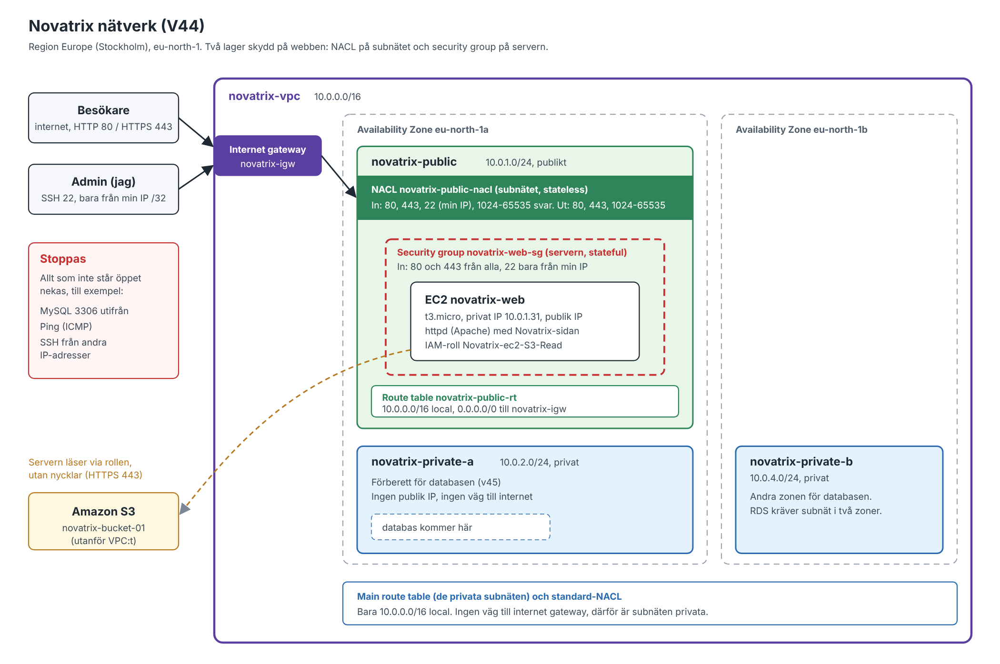

| Trafik | Port | Från | Släpps in? |
|---|---|---|---|
| Webb (HTTP) | 80 | Alla | ✅ Ja |
| Webb (HTTPS) | 443 | Alla | ✅ Ja |
| SSH (admin) | 22 | Bara min IP (`/32`) | ✅ Ja |

---

## Delmoment 1: Repo

Mappen `V44` finns i kursrepot med den här README:n och mappen `Bilder-v44`. README i roten listar V44.

---

## Delmoment 2: Bygg VPC:t

### VPC och subnät

| Resurs | Namn | Intervall | Zon | Typ |
|---|---|---|---|---|
| VPC | `novatrix-vpc` | `10.0.0.0/16` | eu-north-1 | |
| Subnät | `novatrix-public` | `10.0.1.0/24` | eu-north-1a | Publikt |
| Subnät | `novatrix-private-a` | `10.0.2.0/24` | eu-north-1a | Privat |
| Subnät | `novatrix-private-b` | `10.0.4.0/24` | eu-north-1b | Privat |

- `/16` ger VPC:t 65 536 adresser. Varje `/24`-subnät får 256 (251 användbara, AWS reserverar 5).
- De privata subnäten ligger i **två olika zoner**. Databasen (RDS) i V45 kräver det.

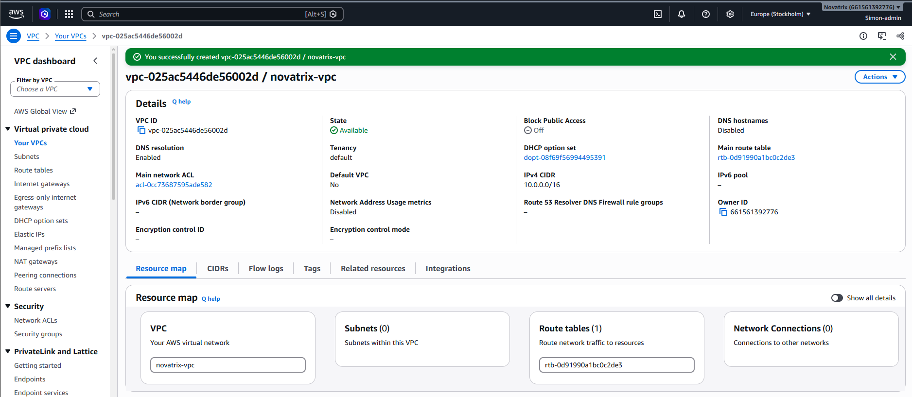

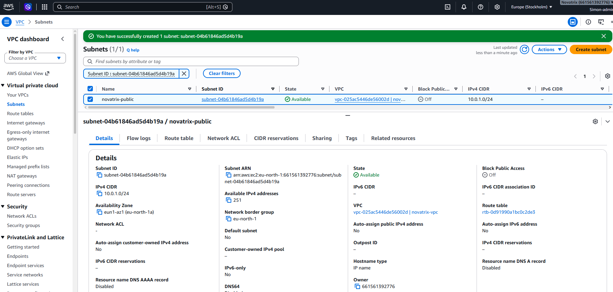

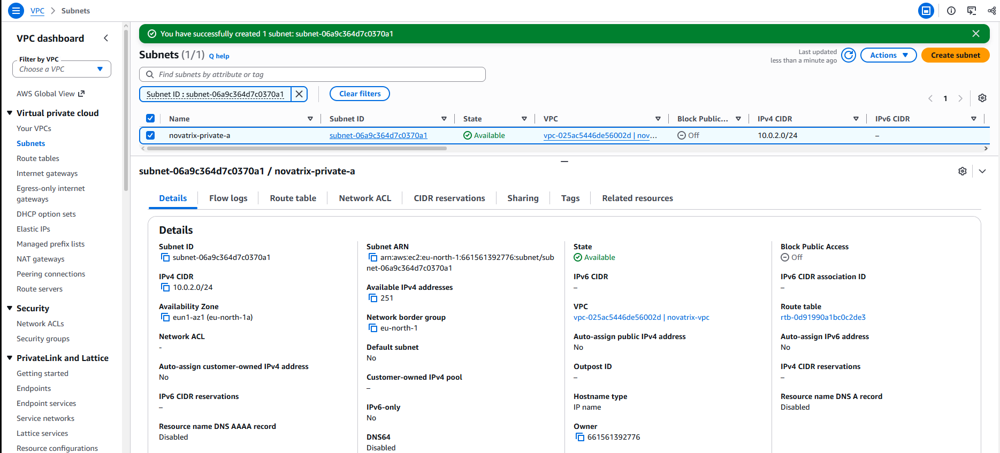

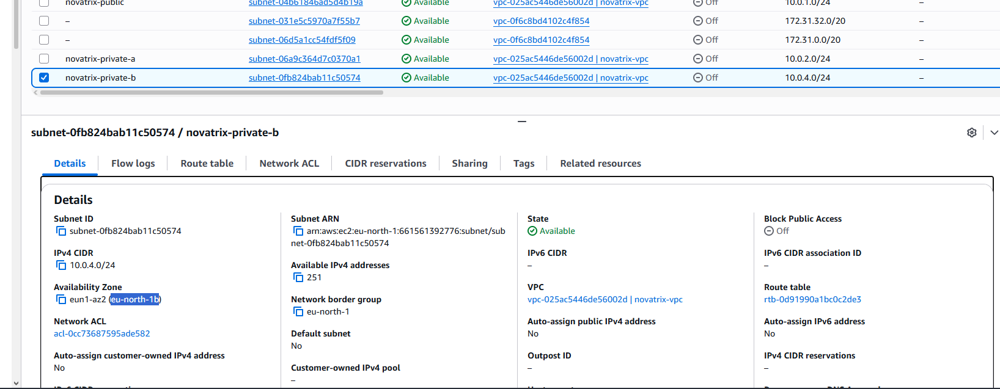

### Internet gateway och routing

Ett subnät blir inte publikt av sitt namn. Det är **routingen** som bestämmer.

- **Internet gateway** `novatrix-igw` är dörren mellan VPC:t och internet. Den är kopplad (*Attached*) till `novatrix-vpc`.
- **Route table** `novatrix-public-rt` har vägen `0.0.0.0/0` till `novatrix-igw` och är kopplad till `novatrix-public`. `0.0.0.0/0` betyder "all trafik som inte ska inom VPC:t".
- **Main route table** har bara vägen `10.0.0.0/16 local`. De privata subnäten använder den och har därför **ingen väg till internet**.

Jag la internetvägen i en egen route table och inte i main route table. Annars hade alla subnät blivit publika, även nya subnät som skapas senare.

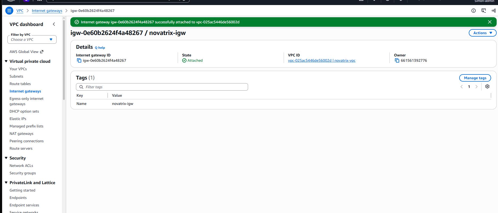

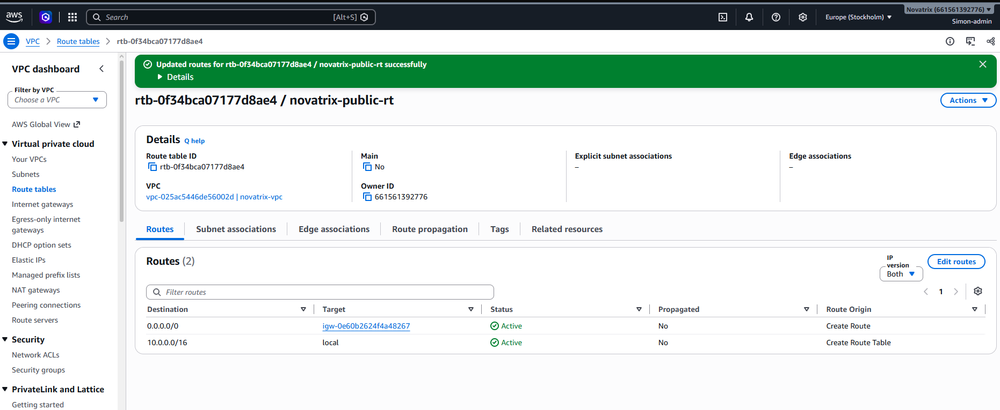

Resource map visar hur allt hänger ihop:

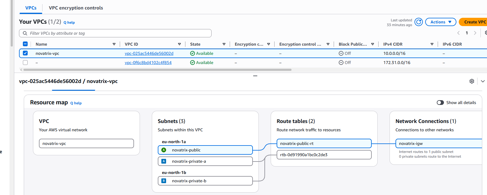

---

## Delmoment 3: Säkra trafiken

Jag använder **två lager**. Om ett lager blir fel finns det andra kvar.

| | Security group | NACL |
|---|---|---|
| Sitter på | Servern | Subnätet |
| Regler | Bara *Allow* | *Allow* och *Deny*, i nummerordning |
| Svarstrafik | Släpps automatiskt (**stateful**) | Måste tillåtas med en egen regel (**stateless**) |

### Security group: novatrix-web-sg

Skapad i `novatrix-vpc`, inte i default-VPC:t.

| Typ | Port | Källa | Varför |
|---|---|---|---|
| HTTP | 80 | `0.0.0.0/0` | Alla ska kunna se webbsidan |
| HTTPS | 443 | `0.0.0.0/0` | Förberett för krypterad webb. Inget certifikat än, så ingen tjänst svarar på 443 ännu. |
| SSH | 22 | `90.226.119.19/32` | Bara jag får logga in |

Utgående regler är standard (allt tillåtet). Security groupen är stateful, så svaren på inkommande trafik släpps tillbaka automatiskt.

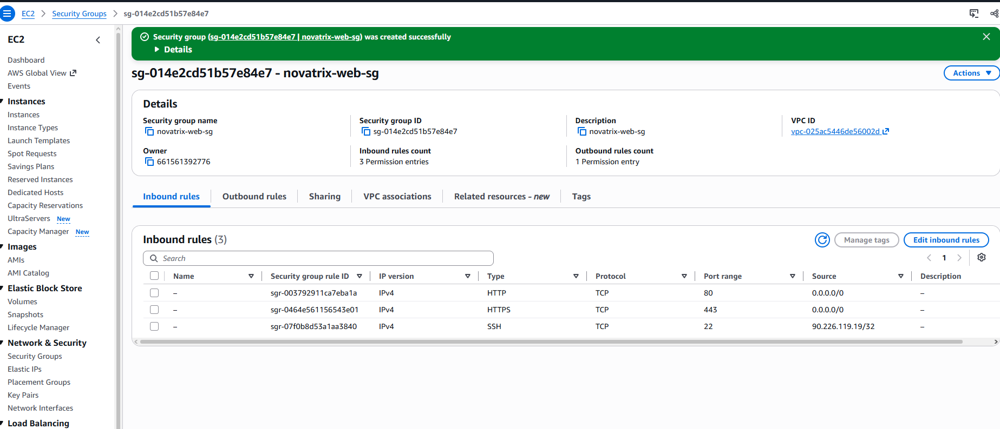

### NACL: novatrix-public-nacl

Kopplad till subnätet `novatrix-public`.

**Inkommande:**

| Regel | Typ | Port | Källa | Varför |
|---|---|---|---|---|
| 100 | HTTP | 80 | `0.0.0.0/0` | Webben |
| 110 | HTTPS | 443 | `0.0.0.0/0` | Webben |
| 120 | SSH | 22 | `90.226.119.19/32` | Admin, bara min IP |
| 130 | Custom TCP | 1024-65535 | `0.0.0.0/0` | Svar på trafik som servern själv startar, till exempel `yum update` och S3 |
| * | Allt | Allt | `0.0.0.0/0` | **Deny**, allt annat |

**Utgående:**

| Regel | Typ | Port | Mål | Varför |
|---|---|---|---|---|
| 100 | HTTP | 80 | `0.0.0.0/0` | Servern hämtar paket |
| 110 | HTTPS | 443 | `0.0.0.0/0` | Servern hämtar paket och når S3 |
| 130 | Custom TCP | 1024-65535 | `0.0.0.0/0` | Svar till besökare och till min SSH |
| * | Allt | Allt | `0.0.0.0/0` | **Deny**, allt annat |


Reglerna läses i **nummerordning**, och den första som matchar gäller. Regeln `*` sist nekar allt som ingen regel har tillåtit.

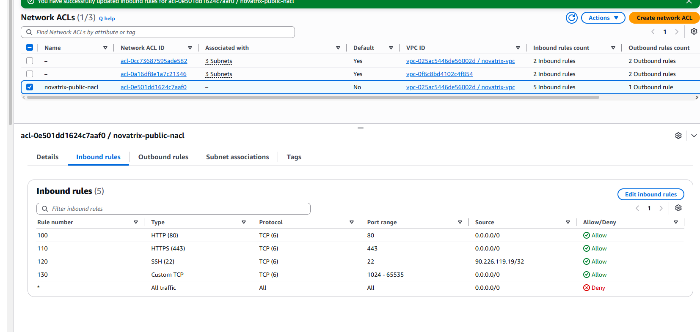

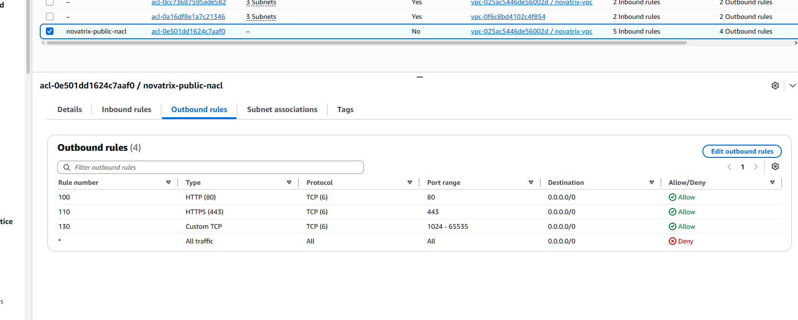

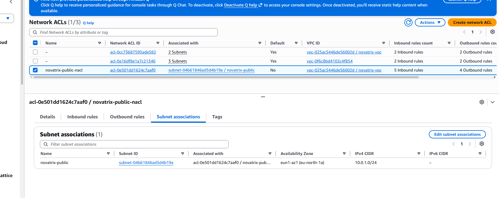

---

## Delmoment 4: Placera lösningen

### Flytta webbservern med en AMI

En EC2-instans kan **inte byta VPC**. Därför flyttade jag servern via en AMI (en kopia av hela servern):

1. Döpte om den gamla servern till `novatrix-web-gammal`.
2. **Actions → Image and templates → Create image** med namnet `novatrix-web-v44`.
3. Startade en ny instans från AMI:n:

| Inställning | Värde |
|---|---|
| Namn | `novatrix-web` |
| Instanstyp | `t3.micro` |
| Key pair | `novatrix-key` |
| VPC och subnät | `novatrix-vpc`, `novatrix-public` |
| Auto-assign public IP | Enable |
| Security group | `novatrix-web-sg` |
| IAM instance profile | `Novatrix-ec2-S3-Read` (från V43) |

Den nya servern fick privat IP `10.0.1.31` (i `novatrix-public`) och publik IP `13.61.185.251`.

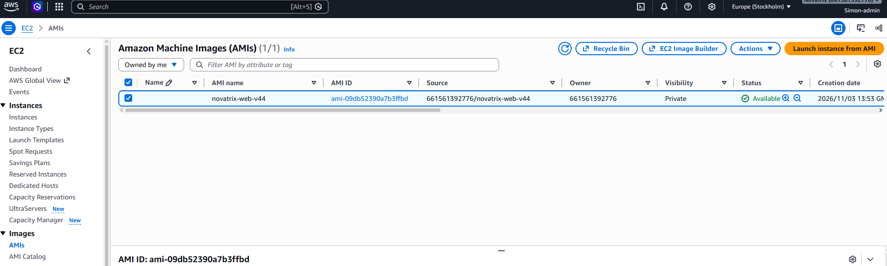

### Förbered för databasen

`novatrix-private-a` och `novatrix-private-b` står tomma. Databasen flyttar in i V45. Den kommer inte kunna nås från internet, eftersom subnäten saknar väg till internet gateway.

---

## Delmoment 5: Verifiering

### Det som ska släppas in

**Webben.** Sidan visas på den nya publika IP-adressen:

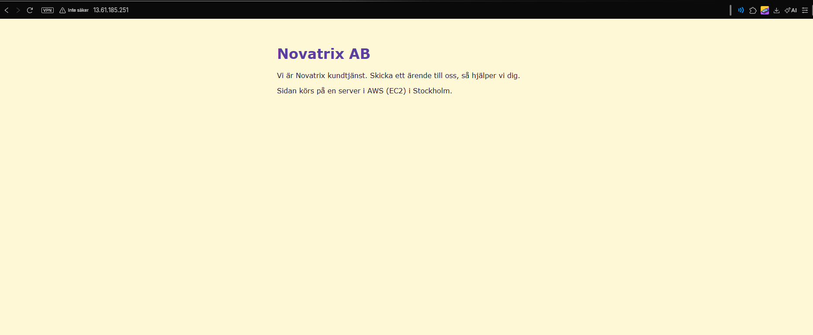

**SSH från min IP:**

```powershell
ssh -i $HOME\.ssh\novatrix-key.pem ec2-user@13.61.185.251
```

Prompten `ec2-user@ip-10-0-1-31` visar att servern ligger i `novatrix-public` (10.0.1.x).

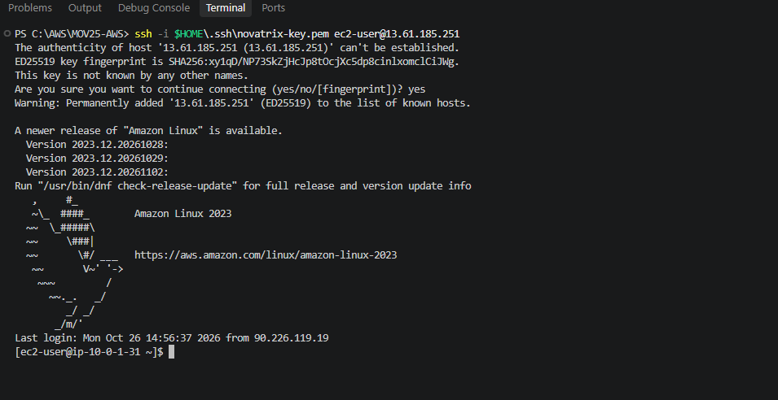

**Rollen och NACL:en.** Efter att NACL:en kopplats till subnätet loggade jag in igen och testade rollen från V43:

```bash
aws s3 ls s3://novatrix-bucket-01
```

```
2026-10-26 12:04:48          0 Text.Bucket.txt
2026-10-26 14:39:32         35 ops-anna-test.txt
```

Det visar tre saker: SSH går genom NACL:en, rollen följde med via AMI:n, och servern når S3 på port 443 genom NACL:ens utgående regler.

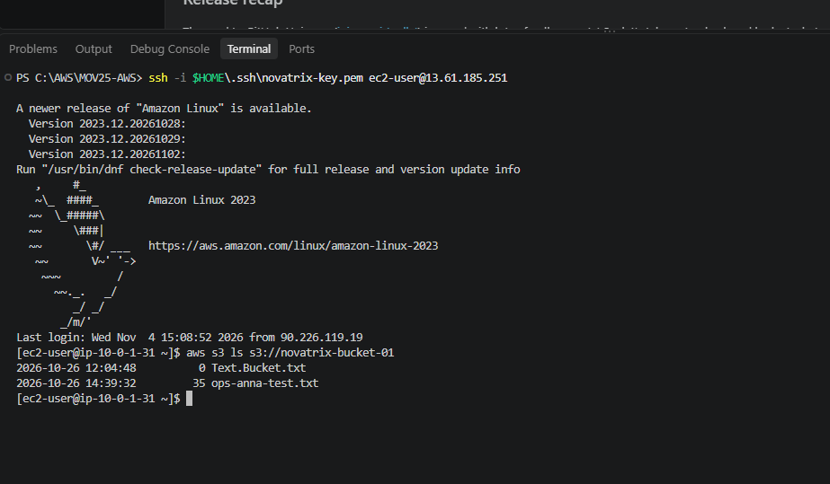

### Det som ska blockeras

Från min dator, i PowerShell:

```powershell
Test-NetConnection 13.61.185.251 -Port 80
Test-NetConnection 13.61.185.251 -Port 3306
```

```
RemotePort       : 80
TcpTestSucceeded : True

WARNING: TCP connect to (13.61.185.251 : 3306) failed
WARNING: Ping to 13.61.185.251 failed with status: TimedOut
RemotePort             : 3306
PingSucceeded          : False
TcpTestSucceeded       : False
```

- **Port 80: True.** Webben släpps in.
- **Port 3306 (MySQL): False.** Den står inte öppen i varken NACL:en eller security groupen.
- **Ping: TimedOut.** Ping (ICMP) är inte öppet i något av lagren.

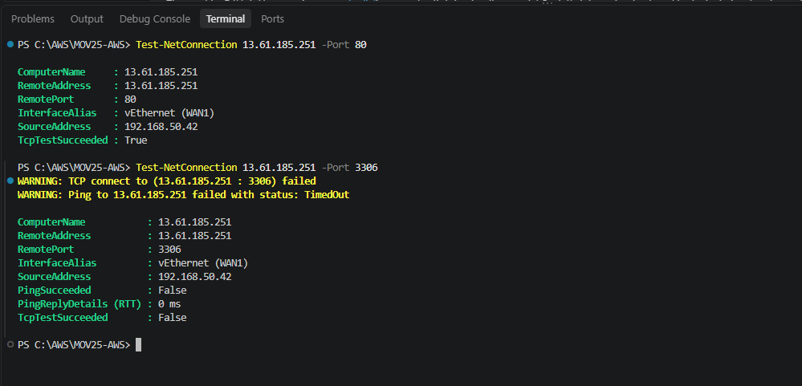

### Sammanfattning

| Test | Förväntat | Resultat |
|---|---|---|
| Webbsidan på port 80 | Släpps in | ✅ |
| SSH från min IP | Släpps in | ✅ |
| Servern når S3 med rollen | Fungerar | ✅ |
| MySQL 3306 utifrån | Blockeras | ✅ |
| Ping | Blockeras | ✅ |

---

## Problem och lösning

**1. NACL:en skyddade ingenting.** Jag hade skapat `novatrix-public-nacl` med rätt regler, men inte kopplat den till något subnät. Då använde subnätet fortfarande standard-NACL:en, som släpper in allt. Jag kopplade den under **Subnet associations** och testade allt igen.

**2. private-b låg i fel zon.** `novatrix-private-b` hamnade i eu-north-1a i stället för eu-north-1b. RDS kräver subnät i två zoner, så det hade stoppat databasen i V45. En zon går inte att ändra, så jag tog bort subnätet och skapade det igen i eu-north-1b.

---

## Städning

- Den gamla servern `novatrix-web-gammal` är avslutad (Terminate).
- AMI:n `novatrix-web-v44` är avregistrerad och dess snapshot borttagen. En snapshot kostar tills den tas bort.
- VPC, subnät, internet gateway, security group och NACL kostar inget och får stå kvar till V45.
- Jag stoppar `novatrix-web` när jag är klar för dagen. Den publika IP:n byts då vid nästa start.
