# AWS - Uppgift 4 (V45)

**Storage och databas**

- **Namn:** Simon Fatty
- **Kurs:** Amazon Web Services, MOV25
- **Repo:** https://github.com/02simfat/AWS-MOV25 (dokumentationen ligger i mappen `V45`)
- **Datum:** 2026-11-13

## Sammanfattning

Novatrix webbserver kör nu **WordPress**. Innehållet (inlägg, sidor, användare) sparas i en hanterad databas, **RDS med MariaDB**. Uppladdade filer, som bilder, sparas på delad lagring, **EFS**. Databasen backas upp automatiskt av RDS, och dessutom läggs en egen backup i en privat **S3-bucket**, där den tas bort automatiskt efter 14 dagar. Databasen och filsystemet ligger i privata subnät och nås bara från webbservern.

## Innehåll

1. Arkitektur
2. Delmoment 1: Repo
3. Delmoment 2: Databas (RDS)
4. Delmoment 3: Delad lagring (EFS)
5. Delmoment 4: Objektlagring och backup (S3)
6. Delmoment 5: Koppla ihop WordPress
7. Delmoment 6: Säkra åtkomsten
8. Delmoment 7: Verifiering
9. Problem och lösning
10. Städning

---

## Arkitektur

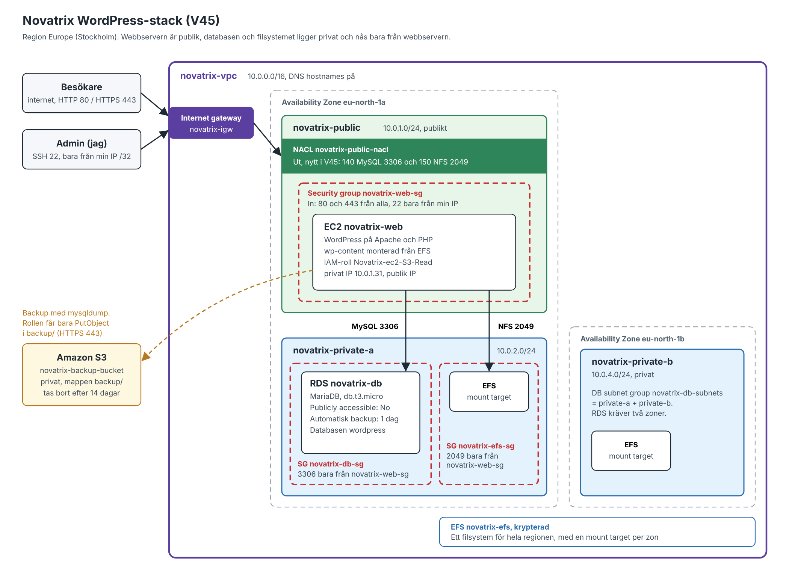

| Tjänst | Vad den sparar | Varför just den |
|---|---|---|
| **RDS** (MariaDB) | Inlägg, sidor, användare | En hanterad databas. AWS sköter uppdateringar och backup. |
| **EFS** | WordPress-filer i `wp-content`, till exempel bilder | Ett filsystem som flera servrar kan dela. Filerna finns kvar om servern byts ut. |
| **S3** | Backup av databasen | Billig och säker objektlagring, och livscykelregler tar bort gamla filer automatiskt. |

---

## Delmoment 1: Repo

Mappen `V45` finns i kursrepot med den här README:n och mappen `Bilder-v45`. README i roten listar V45.

Lösenordet till databasen och filen `wp-config.php` ligger **inte** i repot. RDS-endpointen är maskad i alla bilder och skrivs som `<RDS-endpoint>` i kommandona.

---

## Delmoment 2: Databas (RDS)

### Förberedelser

**DB subnet group** `novatrix-db-subnets` säger vilka subnät databasen får ligga i: `novatrix-private-a` (eu-north-1a) och `novatrix-private-b` (eu-north-1b). RDS kräver subnät i **två zoner**.

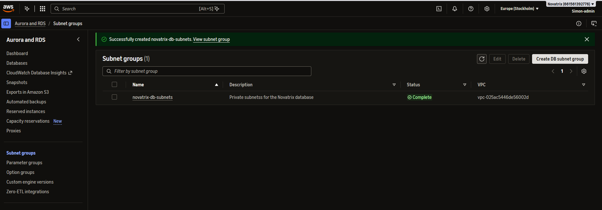

**Security group** `novatrix-db-sg` släpper bara in MySQL (3306) från webbserverns security group:

| Typ | Port | Källa | Varför |
|---|---|---|---|
| MySQL/Aurora | 3306 | `novatrix-web-sg` | Bara webbservern får prata med databasen |

Källan är en **security group** och inte en IP-adress. Då följer regeln med servern, även om den får en ny IP-adress.

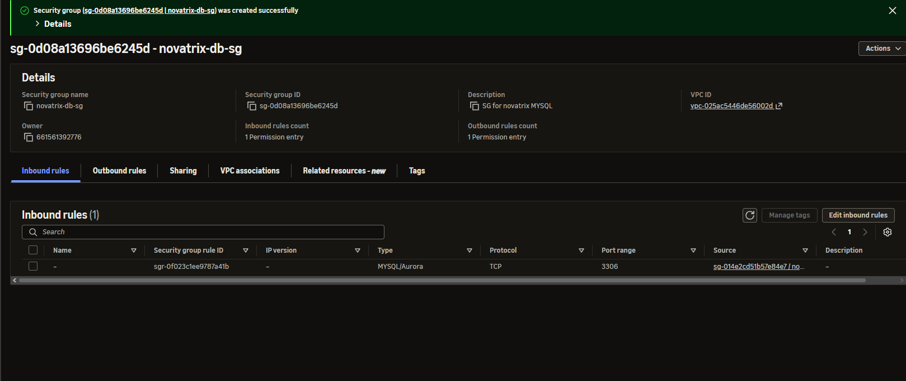

### Databasen

| Inställning | Värde | Varför |
|---|---|---|
| Motor | MariaDB | Fungerar med WordPress |
| Namn | `novatrix-db` | |
| Klass | `db.t3.micro` | Free tier, räcker för en liten sajt |
| Subnät | `novatrix-db-subnets` | Privata subnät |
| Public access | **No** | Databasen ska aldrig nås från internet |
| Security group | `novatrix-db-sg` | |
| Initial database name | `wordpress` | WordPress behöver en databas att skriva i |
| Automatisk backup | 1 dag | Max på Free plan |

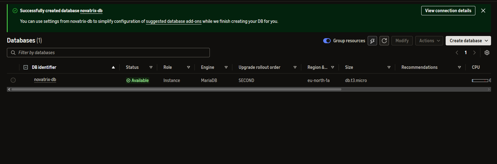

Inställningarna kontrollerade med AWS CLI från min dator:

```powershell
aws rds describe-db-instances --db-instance-identifier novatrix-db --query "DBInstances[0].{Publik:PubliclyAccessible,BackupDagar:BackupRetentionPeriod,Klass:DBInstanceClass}" --output table
```

```
+--------------+---------------+---------+
|  BackupDagar |     Klass     | Publik  |
+--------------+---------------+---------+
|  1           |  db.t3.micro  |  False  |
+--------------+---------------+---------+
```

---

## Delmoment 3: Delad lagring (EFS)

### Förberedelser

**Security group** `novatrix-efs-sg`:

| Typ | Port | Källa | Varför |
|---|---|---|---|
| NFS | 2049 | `novatrix-web-sg` | Bara webbservern får montera filsystemet |

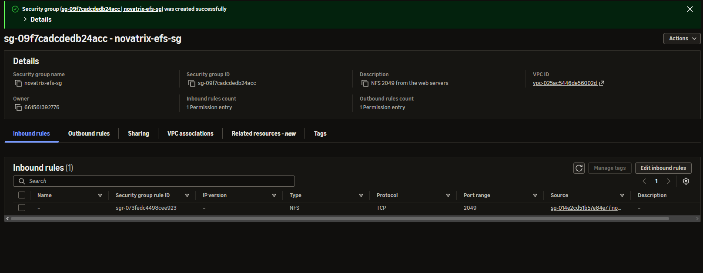

**NACL** `novatrix-public-nacl` fick två nya utgående regler, så att webbservern når databasen och EFS:

| Regel | Typ | Port | Mål | Varför |
|---|---|---|---|---|
| 140 | MySQL | 3306 | `10.0.0.0/16` | Webbservern till databasen |
| 150 | NFS | 2049 | `10.0.0.0/16` | Webbservern till EFS |

Målet är bara VPC:t, inte hela internet. Svaren kommer tillbaka på portarna 1024–65535 (inkommande regel 130 från V44).

**DNS hostnames** slogs på i `novatrix-vpc`. EFS och RDS använder DNS-namn, och utan DNS hostnames går namnen inte att slå upp inne i VPC:t.

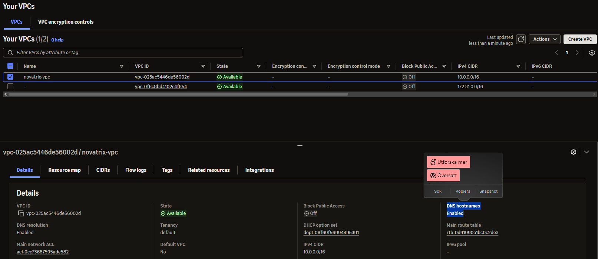

### Filsystemet

EFS `novatrix-efs` (`fs-076d83fcfe98f6e95`) har en **mount target** i varje privat subnät, med security groupen `novatrix-efs-sg`. Filsystemet är **krypterat**.

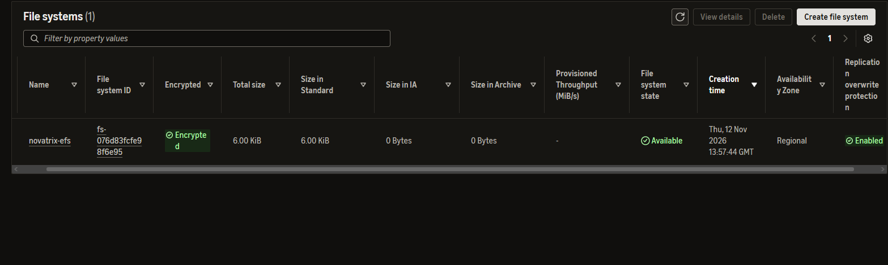

### Montera på webbservern

```bash
sudo dnf install -y amazon-efs-utils
sudo mount -t efs -o tls fs-076d83fcfe98f6e95:/ /var/www/html/wp-content
```

- `amazon-efs-utils` är AWS verktyg för att montera EFS.
- `-o tls` krypterar trafiken mellan servern och EFS.

För att monteringen ska komma tillbaka efter en omstart la jag den här raden i `/etc/fstab`:

```
fs-076d83fcfe98f6e95:/ /var/www/html/wp-content efs _netdev,noresvport,tls 0 0
```

- `_netdev` väntar på nätverket innan monteringen görs.
- `noresvport` gör att servern kan ansluta igen om anslutningen bryts.
- `tls` krypterar trafiken.

Raden testades med `sudo mount -a` innan omstarten.

---

## Delmoment 4: Objektlagring och backup (S3)

### Bucketen

Bucketen `novatrix-backup-bucket` i Stockholm har mappen `backup/`. **Block all public access** är på, så ingen utifrån kan läsa backuperna.

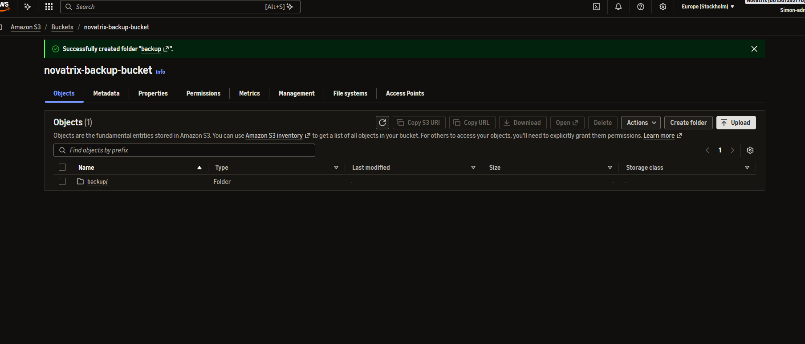

### Livscykelregel: 14 dagar

Regeln `backup-14-dagar` gäller allt under prefixet `backup/`. Filerna tas bort automatiskt **14 dagar** efter att de laddades upp. Då växer kostnaden inte, och gamla backuper försvinner utan att någon behöver komma ihåg det.

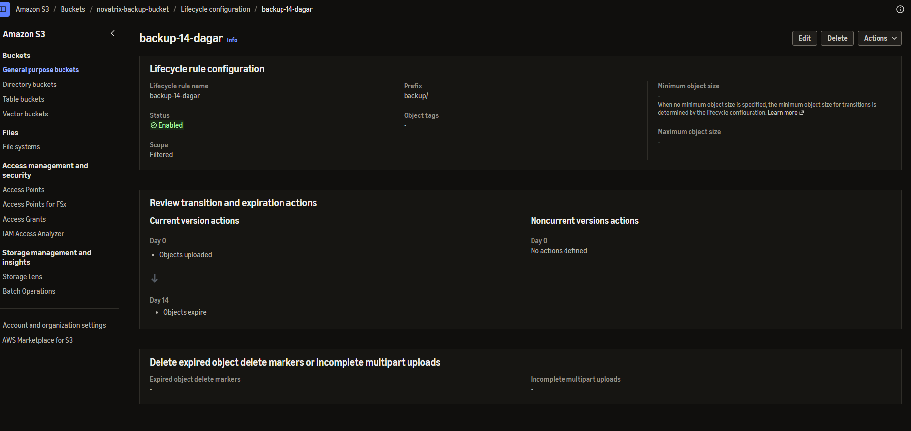

### Rollen får skriva backup

Webbserverns roll `Novatrix-ec2-S3-Read` (från V43) fick inline-policyn `novatrix-s3-backup`:

```json
{
    "Version": "2012-10-17",
    "Statement": [
        {
            "Sid": "WriteBackupsOnly",
            "Effect": "Allow",
            "Action": "s3:PutObject",
            "Resource": "arn:aws:s3:::novatrix-backup-bucket/backup/*"
        }
    ]
}
```

- `s3:PutObject` får bara **ladda upp**. Inte radera, inte skriva över i andra mappar.
- `backup/*` gäller bara mappen `backup/` i den här bucketen.
- Servern behöver alltså inga nycklar för att lägga backup i S3.

Rollen har också kvar `AmazonS3ReadOnlyAccess` från V43. Den ger läsrätt i **alla** buckets, även backupen. Det är bredare än nödvändigt, och det tar jag bort i VG.

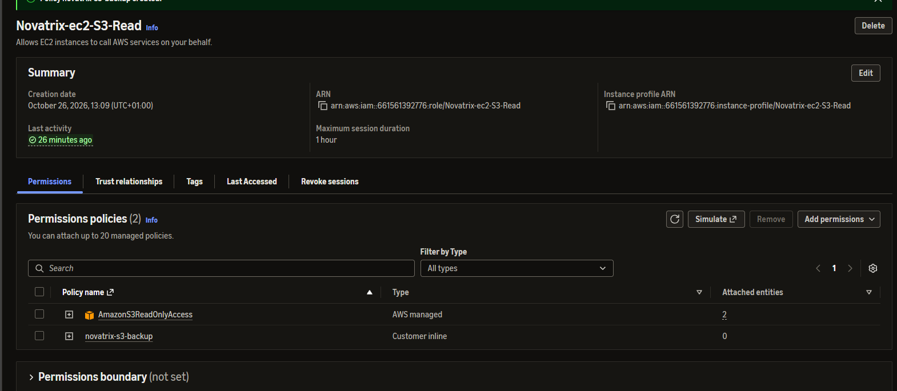

### Backup av databasen till S3

På webbservern:

```bash
mysqldump --single-transaction -h <RDS-endpoint> -u admin -p wordpress > wordpress-2026-11-13.sql
ls -l wordpress-2026-11-13.sql
aws s3 cp wordpress-2026-11-13.sql s3://novatrix-backup-bucket/backup/
```

```
-rw-r--r--. 1 ec2-user ec2-user 1047092 Nov 13 11:28 wordpress-2026-11-13.sql
```

- `mysqldump` sparar hela databasen som en SQL-fil.
- `--single-transaction` tar en ögonblicksbild, så att databasen inte behöver låsas medan backupen görs.
- `-p` gör att lösenordet frågas efter och inte står i kommandot eller i historiken.

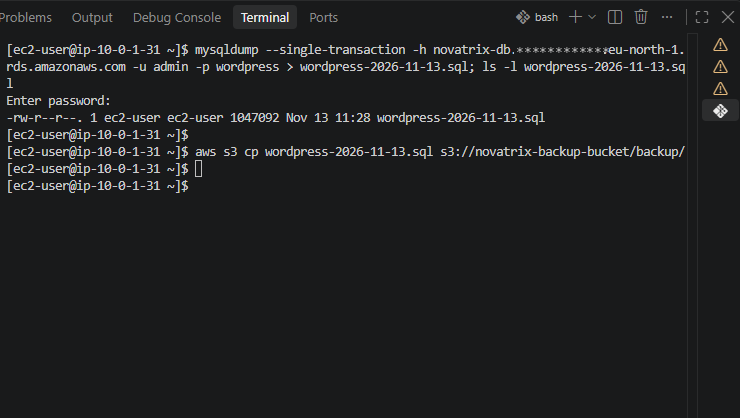

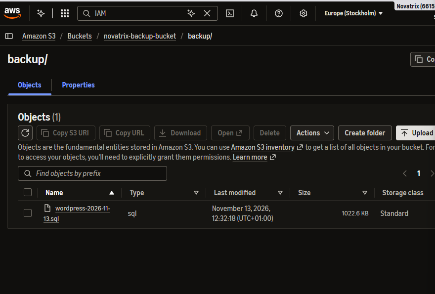

### Automatisk backup i RDS

RDS tar en automatisk backup varje dag och sparar den i **1 dag**, vilket är max på Free plan.

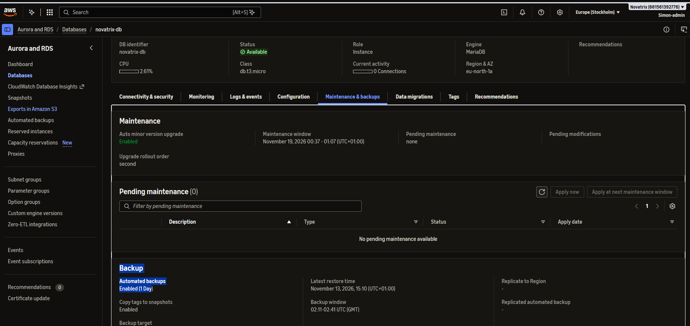

**I drift hade jag valt 7 dagar.** Ett fel, till exempel ett raderat inlägg, märks inte alltid samma dag. Det som går fel en fredag kanske upptäcks först på måndagen. Med 7 dagar går det att återställa databasen till vilken tidpunkt som helst under den senaste veckan. Längre tid än så kostar mer lagring, och de egna dumparna i S3 räcker 14 dagar bakåt. Tillsammans ger det två oberoende backuper.

---

## Delmoment 5: Koppla ihop WordPress

### Installera

```bash
sudo dnf install -y php php-mysqlnd php-gd php-mbstring php-xml mariadb105
cd /tmp
wget https://wordpress.org/latest.tar.gz && tar -xzf latest.tar.gz
sudo cp -r /tmp/wordpress/* /var/www/html/
cd /var/www/html
sudo mv index.html index-v42.html
sudo chown -R apache:apache /var/www/html
sudo systemctl enable --now php-fpm
sudo systemctl restart httpd
```

- `php` med tillägg: WordPress är skrivet i PHP. `php-mysqlnd` gör att PHP kan prata med databasen.
- `mariadb105` ger kommandona `mysql` och `mysqldump` på servern.
- `index.html` från V42 byttes namn, annars visas den i stället för WordPress.
- `chown apache:apache` ger webbservern rätt att skriva, till exempel när en bild laddas upp.
- `enable --now php-fpm` startar PHP nu och vid varje omstart.

### Koppla mot databasen

I installationsguiden angav jag databasen `wordpress`, användaren `admin` och **RDS-endpointen** som Database Host (inte `localhost`, eftersom databasen inte ligger på servern).

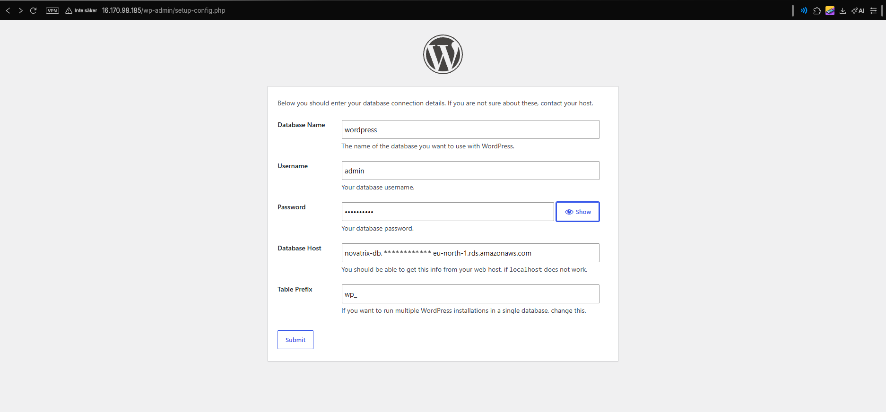

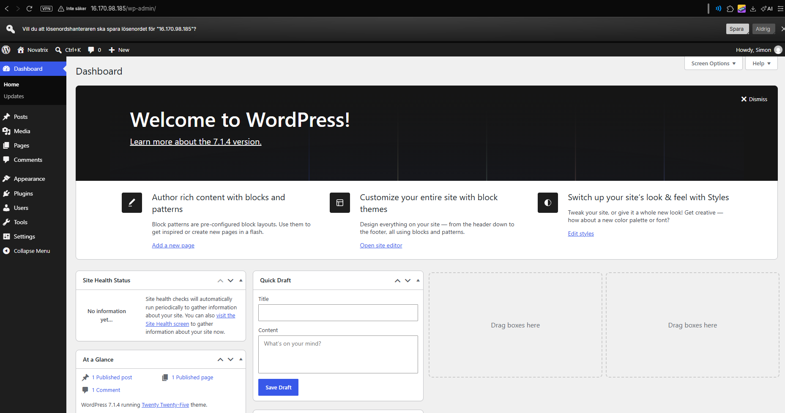

Jag skrev ett inlägg med en bild. Inlägget sparas i RDS och bilden på EFS.

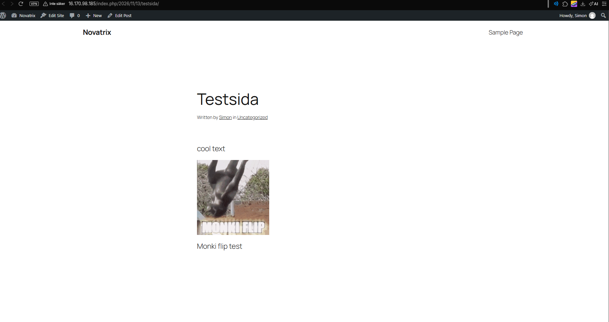

---

## Delmoment 6: Säkra åtkomsten

Åtkomsten skyddas i flera lager:

| Lager | Hur det skyddar |
|---|---|
| **Privata subnät** | RDS och EFS ligger i subnät utan väg från internet |
| **RDS** | *Publicly accessible: No*, databasen har ingen publik adress |
| **NACL** | Webbens subnät släpper bara ut 3306 och 2049 till VPC:t, inte till internet |
| **Security groups** | Databasen och EFS tar bara emot trafik från `novatrix-web-sg`, grupp mot grupp |
| **IAM** | Rollen får ladda upp i `backup/` men inte radera. Ingen nyckel finns på servern. |
| **S3** | *Block all public access* på bucketen |
| **Kryptering** | EFS är krypterat, och trafiken till EFS går över TLS |
| **Hemligheter** | Lösenordet och `wp-config.php` finns bara på servern, aldrig i repot |

---

## Delmoment 7: Verifiering

### WordPress läser från databasen

```bash
mysql -h <RDS-endpoint> -u admin -p -e "SELECT post_title FROM wordpress.wp_posts;"
```

```
+------------------------------+
| post_title                   |
+------------------------------+
| Hello world!                 |
| Sample Page                  |
| Privacy Policy               |
| Navigation                   |
| Auto Draft                   |
| Testsida                     |
| Custom Styles                |
| Skärmbild 2026-04-26 192020  |
| Testsida                     |
+------------------------------+
```

Mitt inlägg **Testsida** och bilden **Skärmbild 2026-04-26 192020** finns i databasen.

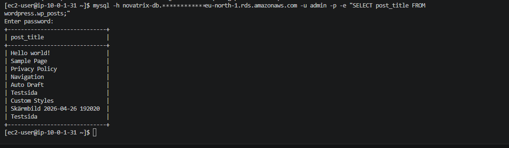

### Filerna ligger på EFS

```bash
df -h /var/www/html/wp-content
ls /var/www/html/wp-content/uploads/2026/11
```

```
Filesystem      Size  Used Avail Use% Mounted on
127.0.0.1:/     8.0E     0  8.0E   0% /var/www/html/wp-content

Skarmbild-2026-04-26-192020-150x150.png  Skarmbild-2026-04-26-192020-213x300.png  Skarmbild-2026-04-26-192020.png
```

- `127.0.0.1:/` och `8.0E` betyder att det är EFS (via TLS), inte serverns egen disk.
- Bilden från inlägget ligger på EFS.

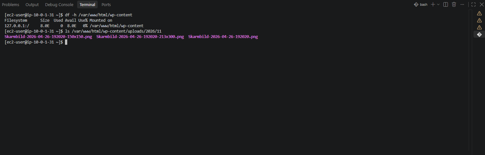

### Allt fungerar efter omstart

Jag startade om servern med `sudo reboot` och kontrollerade igen:

```bash
df -h /var/www/html/wp-content
systemctl is-active httpd php-fpm
```

```
Filesystem      Size  Used Avail Use% Mounted on
127.0.0.1:/     8.0E   17M  8.0E   1% /var/www/html/wp-content
active
active
```

EFS monterades automatiskt från `/etc/fstab`, och både webbservern och PHP startade av sig själva.

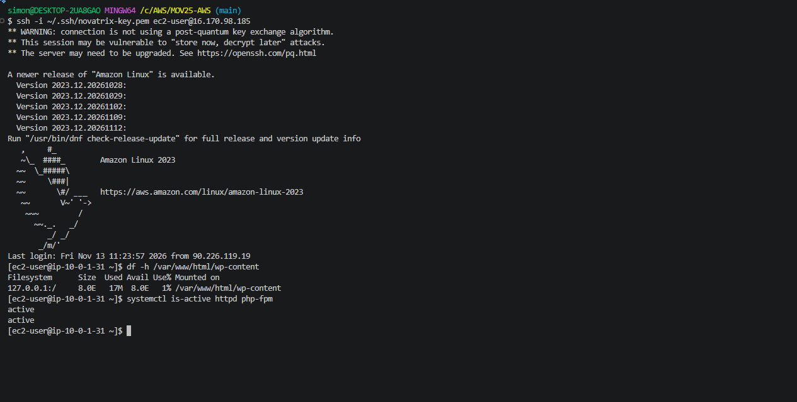

### Backupen ligger i S3

```bash
aws s3 ls s3://novatrix-backup-bucket/backup/
```

```
2026-11-12 14:28:40          0
2026-11-13 11:32:18    1047092 wordpress-2026-11-13.sql
```

Den första raden är själva mappen `backup/`. Den andra är databasdumpen.

### Sammanfattning

| Test | Resultat |
|---|---|
| WordPress visar inlägg med bild | ✅ |
| Inläggen finns i RDS (`SELECT`) | ✅ |
| Bilderna ligger på EFS (`df -h`, `ls`) | ✅ |
| EFS och PHP fungerar efter omstart | ✅ |
| Databasen är inte publik | ✅ `Publik: False` |
| RDS har automatisk backup | ✅ 1 dag |
| Backup finns i S3 | ✅ |
| Backuper tas bort efter 14 dagar | ✅ Livscykelregel |

---

## Problem och lösning

**1. "PHP is not running".** Efter installationen visade WordPress sin PHP-kod som text.

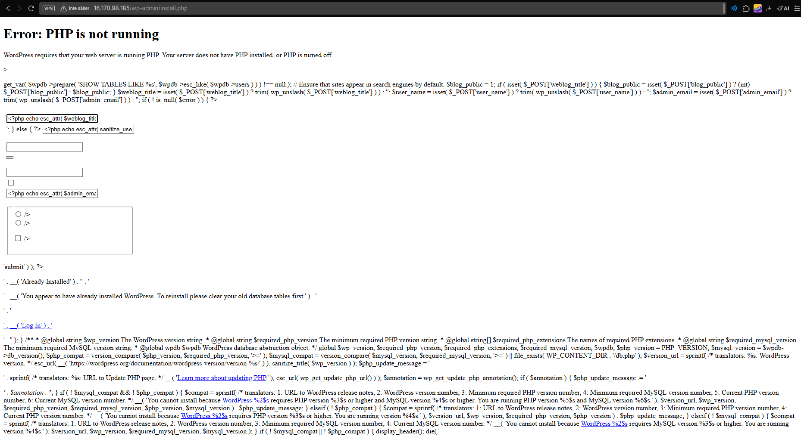

Apache (`httpd`) var redan igång sedan V42. `systemctl start` på en tjänst som redan kör gör ingenting, så Apache läste aldrig in den nya PHP-inställningen. Lösningen var `sudo systemctl restart httpd`, som stoppar och startar och läser in inställningarna på nytt.

**2. EFS var inte monterad.** WordPress fungerade, men `df -h` visade serverns egen disk (`/dev/nvme0n1p1`) i stället för EFS. Två saker var fel:

- Raden i `/etc/fstab` hade fel id (`fs-05668a2b15f86bfcf` i stället för `fs-076d83fcfe98f6e95`). Efter en omstart misslyckades monteringen tyst.
- `php-fpm` var `disabled` och skulle inte ha startat efter en omstart.

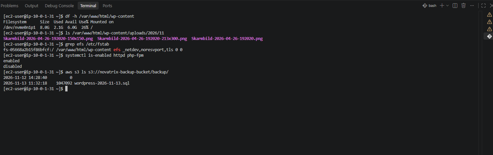

Lösningen:

```bash
sudo systemctl stop httpd
sudo mv /var/www/html/wp-content /var/www/html/wp-content-lokal
sudo mkdir /var/www/html/wp-content
sudo sed -i 's/fs-05668a2b15f86bfcf/fs-076d83fcfe98f6e95/' /etc/fstab
sudo mount -a
sudo cp -a /var/www/html/wp-content-lokal/. /var/www/html/wp-content/
sudo chown -R apache:apache /var/www/html/wp-content
sudo systemctl enable --now php-fpm
sudo systemctl start httpd
```

Jag flyttade undan de lokala filerna, rättade id:t, monterade EFS och kopierade tillbaka filerna. Sedan testade jag med en omstart (se Verifiering). Till sist tog jag bort den lokala kopian.

**3. Fel port i NACL:en.** Regel 150 fick först port `2024` i stället för `2049`. Jag rättade den. EFS fungerade ändå, eftersom regel 130 (1024–65535) redan släppte ut trafiken. Det betyder att regel 130 är bredare än den behöver vara, och det tittar jag på i VG.

---

## Städning

- Jag stoppar `novatrix-web` och `novatrix-db` när jag är klar för dagen. En stoppad RDS startar själv igen efter sju dagar.
- Hela stacken får stå kvar, eftersom den behövs i V46.
- Databasdumpen på servern tas bort efter uppladdningen. Kopian i S3 försvinner automatiskt efter 14 dagar.
