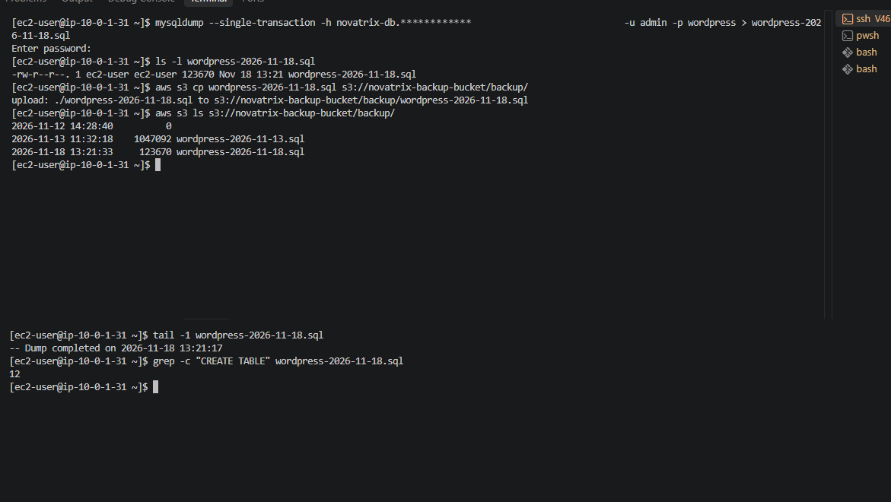
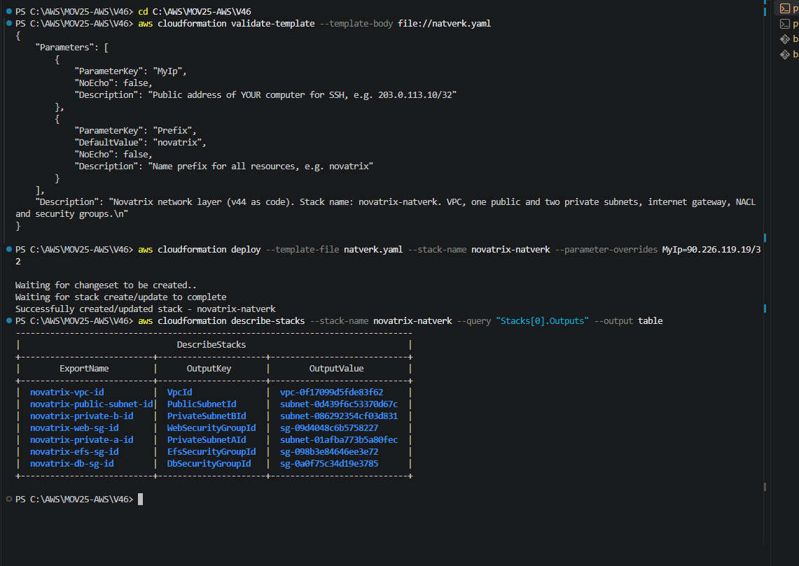
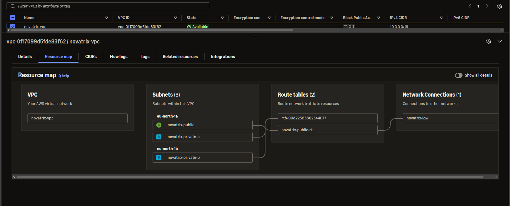
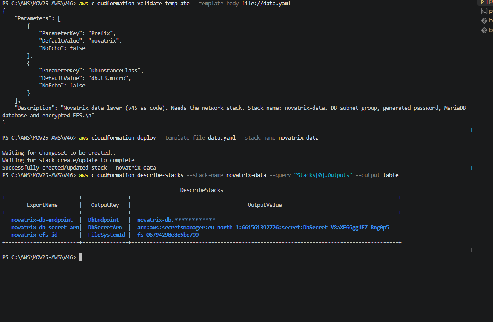
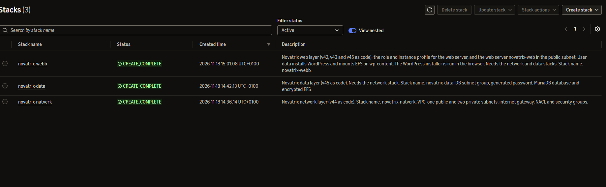
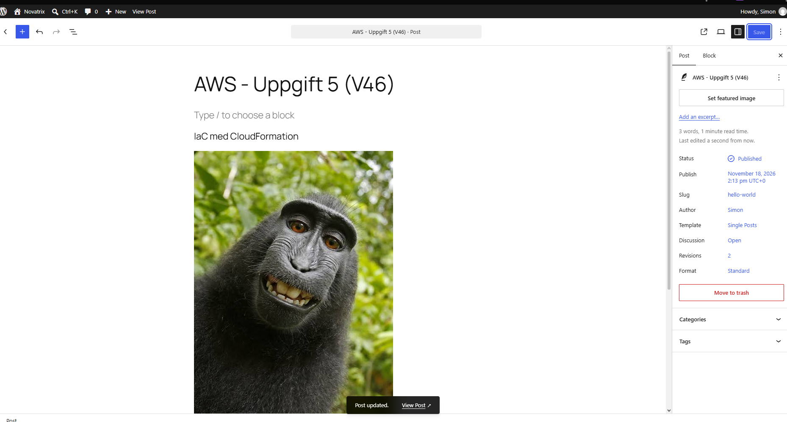
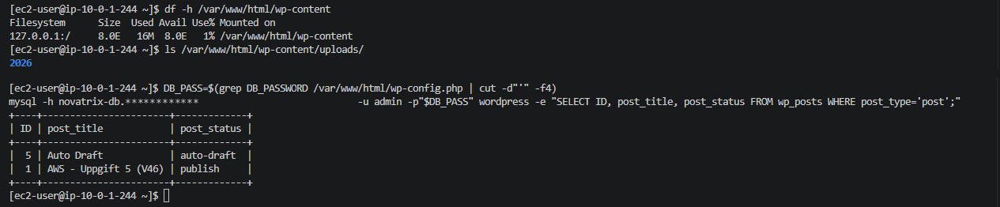
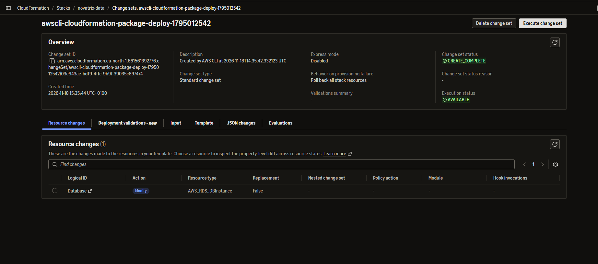
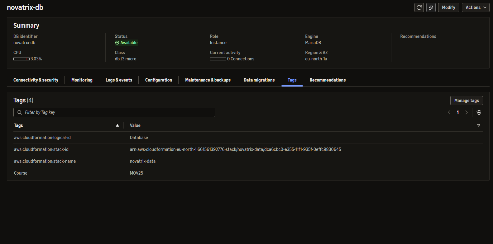
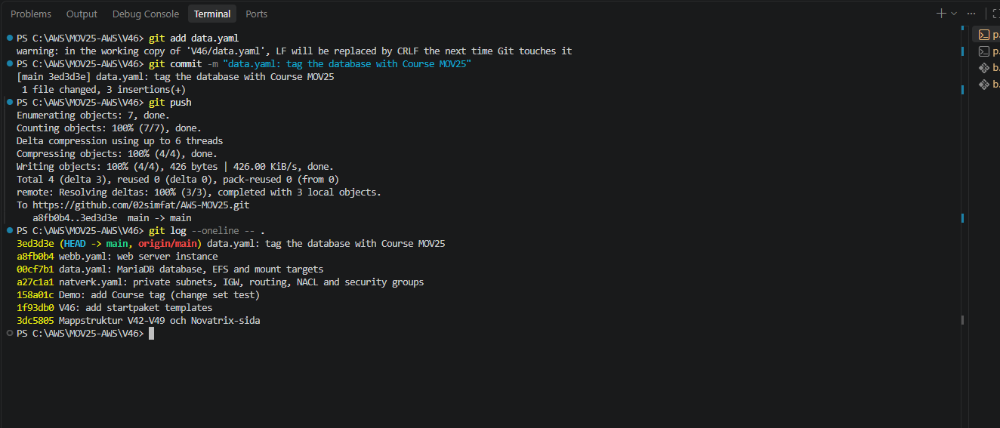

# AWS - Uppgift 5 (V46)

**IaC med CloudFormation**

- **Namn:** Simon Fatty
- **Kurs:** Amazon Web Services, MOV25
- **Repo:** https://github.com/02simfat/AWS-MOV25 (dokumentationen ligger i mappen `V46`)
- **Datum:** 2026-11-18

## Sammanfattning

Novatrix WordPress-miljö från V44 och V45 är nu **kod**. Tre CloudFormation-templates i repot bygger nätet, databasen med lagringen och webbservern, som tre stackar. Den handbyggda miljön är riven och ersatt av stackarna, med samma namn som förut. Bucketarna och mitt key pair ligger utanför stackarna. Efter idag ändras miljön i filerna, inte i konsolen.

## Innehåll

1. Översikt: tre stackar
2. Delmoment 1: Repo
3. Delmoment 2: Templates
4. Delmoment 3: Deploy och verifiering
5. Delmoment 4: Versionshantering
6. Delmoment 5: Återskapa miljön från repot
7. Problem och lösning
8. Städning och kostnad

---

## Översikt: tre stackar

| Stack | Fil | Innehåll |
|---|---|---|
| `novatrix-natverk` | `natverk.yaml` | VPC, ett publikt och två privata subnät, internet gateway, route table, NACL och tre security groups |
| `novatrix-data` | `data.yaml` | DB subnet group, lösenord i Secrets Manager, MariaDB (RDS), EFS med två mount targets |
| `novatrix-webb` | `webb.yaml` | IAM-roll, instance profile och webbservern `novatrix-web` med WordPress |

Stackarna hänger ihop med **Export** och **!ImportValue**:

```
novatrix-natverk
   exporterar: VPC, subnät och security groups (7)
        |
        v  !ImportValue
novatrix-data
   exporterar: databasens endpoint, hemlighetens ARN och EFS-id (3)
        |
        v  !ImportValue
novatrix-webb  (importerar från båda)

Utanför stackarna: novatrix-bucket-01, novatrix-backup-bucket, novatrix-key
```

- **Bygg** i ordningen nät, data, webb. Datastacken behöver subnäten, och webbservern behöver EFS-id:t.
- **Riv** i omvänd ordning. En export som används av en annan stack kan inte tas bort.
- **Bucketarna ligger utanför**, så att backuperna finns kvar när miljön rivs. CloudFormation kan dessutom inte ta bort en bucket som har innehåll.

---

## Delmoment 1: Repo

```
V46/
├── natverk.yaml        nätverksstacken
├── data.yaml           datastacken
├── webb.yaml           webbstacken
├── demo/
│   ├── forsta-template.yaml
│   └── parametrar.yaml
├── Bilder-v46/
└── README.md
```

- Templaterna kommer från lärarens startpaket. Delarna som var markerade **TODO** har jag skrivit.
- I `demo/` ligger de två övningsfilerna. Med dem provade jag hela flödet först: validera, deploya, change set och riva stacken `novatrix-demo`.
- README i roten listar V46.

---

## Delmoment 2: Templates

### Parametrar: det som varierar

| Parameter | Stack | Värde | Varför parameter |
|---|---|---|---|
| `Prefix` | alla | `novatrix` | Alla namn byggs med prefixet, så samma filer kan bygga en kopia |
| `MyIp` | natverk | min IP `/32` | Min IP ändras, filen ska inte behöva det |
| `DbInstanceClass` | data | `db.t3.micro` | Kan behöva bli större. `AllowedValues` stoppar fel värden |
| `KeyName` | webb | `novatrix-key` | Typen `AWS::EC2::KeyPair::KeyName` kontrollerar att nyckeln finns |
| `DataBucket`, `BackupBucket` | webb | mina bucketar | Bucketnamn är unika för varje person |
| `LatestAmiId` | webb | senaste Amazon Linux 2023 | Slås upp vid deploy, så inget AMI-id blir gammalt |

Adressintervallen (`10.0.0.0/16` och subnäten) är hårdkodade, eftersom de inte ändras.

### Viktiga val i koden

- **Zoner med `!GetAZs`.** `!Select [0, !GetAZs ""]` ger första zonen, så `eu-north-1a` står inte i filen.
- **NACL-kopplingen finns i koden.** I V44 glömde jag koppla NACL:en till subnätet. Nu är `PublicSubnetNacl` en resurs och kan inte glömmas. Regel 150 är **2049** (NFS), så felet från V45 är rättat.
- **Security groups med grupp som källa.** Databasen och EFS släpper bara in trafik från `novatrix-web-sg`.
- **Lösenordet i Secrets Manager.** Det genereras och läses av databasen, så ingen människa skriver det och det finns aldrig i repot:

```yaml
MasterUserPassword: !Sub "{{resolve:secretsmanager:${DbSecret}:SecretString:password}}"
```

- **`DeletionPolicy: Delete` på databasen.** Annars tas en slutlig snapshot när stacken rivs, och den kostar pengar. Datan sparas i stället med mysqldump till S3.
- **Rollen har least privilege.** Den får bara läsa `novatrix-bucket-01` och bara skriva i `backup/` i backupbucketen. Den handbyggda rollen hade `AmazonS3ReadOnlyAccess`, som gav läsrätt i alla buckets.
- **Import av värden från en annan stack:**

```yaml
SubnetId: !ImportValue {"Fn::Sub": "${Prefix}-public-subnet-id"}
```

`!ImportValue` och `!Sub` kan inte båda skrivas i kort form direkt i varandra. Därför skrivs den inre i lång form.

---

## Delmoment 3: Deploy och verifiering

CloudFormation tar inte över resurser som redan finns. Templaterna använder samma namn som min handbyggda miljö, så övergången gjordes i tre steg: **backup, riv, deploya**.

### 1. Backup

På webbservern, med samma flöde som i V45:

```bash
mysqldump --single-transaction -h <RDS-endpoint> -u admin -p wordpress > wordpress-2026-11-18.sql
aws s3 cp wordpress-2026-11-18.sql s3://novatrix-backup-bucket/backup/
tail -1 wordpress-2026-11-18.sql
grep -c "CREATE TABLE" wordpress-2026-11-18.sql
```

`Dump completed` och **12** tabeller visar att dumpen är hel. Först när det var kontrollerat rev jag något.



### 2. Riv det handbyggda

| # | Resurs | Varför den måste bort |
|---|---|---|
| 1 | EC2 `Novatrix-web-new` | Ligger i det gamla VPC:t |
| 2 | RDS `novatrix-db` (ingen final snapshot) | Samma namn som i `data.yaml` |
| 3 | EFS `novatrix-efs` | Mount targets i det gamla VPC:t |
| 4 | Subnet group `novatrix-db-subnets` | Samma namn som i `data.yaml` |
| 5 | VPC `novatrix-vpc` med allt innehåll | Ersätts av nätverksstacken |
| 6 | IAM-roll `Novatrix-ec2-S3-Read` | IAM ser inte skillnad på stora och små bokstäver, så den krockar med `novatrix-ec2-s3-read` |

Bucketarna och `novatrix-key` revs inte.

### 3. Deploya

Validera först, deploya sedan, i ordningen nät, data, webb:

```powershell
cd C:\AWS\MOV25-AWS\V46
aws cloudformation validate-template --template-body file://natverk.yaml
aws cloudformation deploy --template-file natverk.yaml --stack-name novatrix-natverk --parameter-overrides MyIp=<min-ip>/32

aws cloudformation validate-template --template-body file://data.yaml
aws cloudformation deploy --template-file data.yaml --stack-name novatrix-data

aws cloudformation validate-template --template-body file://webb.yaml
aws cloudformation deploy --template-file webb.yaml --stack-name novatrix-webb --capabilities CAPABILITY_NAMED_IAM --parameter-overrides KeyName=novatrix-key DataBucket=novatrix-bucket-01 BackupBucket=novatrix-backup-bucket
```

- Datastacken tar ungefär 10 minuter, eftersom databasen tar tid att skapa.
- `CAPABILITY_NAMED_IAM` behövs för att stacken skapar en IAM-roll med eget namn. Utan flaggan stoppar AWS deployen.

**Nätverksstacken**, med 7 exporter och VPC:t i Resource map:





**Datastacken**, med 3 exporter:



**Alla tre stackarna** har status `CREATE_COMPLETE`:



### 4. WordPress

Databasens lösenord hämtas från Secrets Manager:

```powershell
$arn = aws cloudformation describe-stacks --stack-name novatrix-data --query "Stacks[0].Outputs[?OutputKey=='DbSecretArn'].OutputValue" --output text
aws secretsmanager get-secret-value --secret-id $arn --query SecretString --output text
```

I installationsguiden är Database Host `DbEndpoint` från datastacken, och Database Name är `wordpress`. Sedan skrev jag ett inlägg med en bild.



### 5. Verifiering på servern

```bash
df -h /var/www/html/wp-content
ls /var/www/html/wp-content/uploads/
DB_PASS=$(grep DB_PASSWORD /var/www/html/wp-config.php | cut -d"'" -f4)
mysql -h <RDS-endpoint> -u admin -p"$DB_PASS" wordpress -e "SELECT ID, post_title, post_status FROM wp_posts WHERE post_type='post';"
```

```
Filesystem      Size  Used Avail Use% Mounted on
127.0.0.1:/     8.0E   16M  8.0E   1% /var/www/html/wp-content
2026
| ID | post_title            | post_status |
|  1 | AWS - Uppgift 5 (V46) | publish     |
```



| Test | Visar | Resultat |
|---|---|---|
| Tre stackar `CREATE_COMPLETE` | Deployen fungerade | ✅ |
| WordPress-guiden når databasen | Endpoint, lösenord, NACL och security groups stämmer | ✅ |
| `127.0.0.1:/` på 8.0E | EFS är monterat med TLS via user data | ✅ |
| `uploads/2026` | Bilden ligger på EFS | ✅ |
| Inlägget i `wp_posts` | Innehållet ligger i RDS | ✅ |

---

## Delmoment 4: Versionshantering

### Ändringen

Jag la till taggen `Course = MOV25` på databasen i `data.yaml`:

```yaml
      DeleteAutomatedBackups: true
      Tags:
        - Key: Course
          Value: MOV25
```

### Flödet

```powershell
aws cloudformation validate-template --template-body file://data.yaml
aws cloudformation deploy --template-file data.yaml --stack-name novatrix-data --no-execute-changeset
git add data.yaml
git commit -m "data.yaml: tag the database with Course MOV25"
```

Sedan körde jag change setet i konsolen och pushade:

```powershell
git push
git log --oneline -- .
```

**Change setet** visar `Modify` på `Database` med **Replacement False**. Databasen ändras på plats och behåller sin data. Hade det stått `True` hade CloudFormation byggt en ny, tom databas. Därför granskar jag change setet innan det körs.





### Historiken

```
3ed3d3e data.yaml: tag the database with Course MOV25
a8fb0b4 webb.yaml: web server instance
00cf7b1 data.yaml: MariaDB database, EFS and mount targets
a27c1a1 natverk.yaml: private subnets, IGW, routing, NACL and security groups
158a01c Demo: add Course tag (change set test)
1f93db0 V46: add startpaket templates
3dc5805 Mappstruktur V42-V49 och Novatrix-sida
```



### Hur versionshantering hjälper drift och samarbete

- **Spårbart.** Varje ändring i miljön har en commit som visar vad som ändrades, när och varför. Om något går sönder kan man se vad som ändrades precis innan.
- **Går att ångra.** En tidigare version av filen kan deployas igen.
- **Granskning före ändring.** En kollega kan läsa diffen innan den deployas. En för öppen brandväggsregel syns direkt i `git diff`.
- **Commit före deploy.** Då stämmer historiken i Git alltid med miljön i AWS.
- **En sanning.** Alla bygger från samma filer. Ingen kunskap finns bara i någons huvud eller i en klickning i konsolen.

---

## Delmoment 5: Återskapa miljön från repot

### Det här behövs först

- AWS CLI inloggad som adminanvändaren, i regionen `eu-north-1`
- Key pair `novatrix-key`
- Bucketarna `novatrix-bucket-01` och `novatrix-backup-bucket`

### Bygg

```powershell
git clone https://github.com/02simfat/AWS-MOV25.git
cd AWS-MOV25\V46

# 1. Nätet. Egen IP från https://checkip.amazonaws.com
aws cloudformation deploy --template-file natverk.yaml --stack-name novatrix-natverk --parameter-overrides MyIp=<din-ip>/32

# 2. Data, ca 10 minuter
aws cloudformation deploy --template-file data.yaml --stack-name novatrix-data

# 3. Webb
aws cloudformation deploy --template-file webb.yaml --stack-name novatrix-webb --capabilities CAPABILITY_NAMED_IAM --parameter-overrides KeyName=novatrix-key DataBucket=novatrix-bucket-01 BackupBucket=novatrix-backup-bucket

# 4. Adressen till sajten
aws cloudformation describe-stacks --stack-name novatrix-webb --query "Stacks[0].Outputs" --output table
```

5. Vänta några minuter. User data installerar WordPress efter att stacken är klar.
6. Hämta lösenordet med `get-secret-value` (se Delmoment 3) och kör WordPress installationsguide på `WebUrl`.

Kontrollera att allt finns:

```powershell
aws cloudformation list-stacks --stack-status-filter CREATE_COMPLETE UPDATE_COMPLETE --query "StackSummaries[].[StackName,StackStatus]" --output table
```

### Riv

I omvänd ordning: webb, data, nät.

```powershell
aws cloudformation delete-stack --stack-name novatrix-webb
aws cloudformation wait stack-delete-complete --stack-name novatrix-webb
aws cloudformation delete-stack --stack-name novatrix-data
aws cloudformation wait stack-delete-complete --stack-name novatrix-data
aws cloudformation delete-stack --stack-name novatrix-natverk
aws cloudformation wait stack-delete-complete --stack-name novatrix-natverk
```

| Försvinner | Finns kvar |
|---|---|
| Server, databas, EFS, nät, roll och lösenord | Templaterna i repot |
| Databasens innehåll | Dumpen i `novatrix-backup-bucket` (i 14 dagar) |
| Filer i `wp-content` | Bucketarna och `novatrix-key` |

Ta alltid en backup innan rivning om innehållet ska sparas. En ny databas betyder en ny WordPress-installation.

---

## Problem och lösning

**1. `<RDS-endpoint>` gav "No such file or directory".** Jag skrev platshållaren som den stod. I bash betyder `<` "läs in från en fil", så bash letade efter en fil som hette `RDS-endpoint`. mysqldump kördes aldrig, och felen efter var följdfel. Lösning: byt ut platshållaren mot det riktiga värdet.

**2. mysql gav `ERROR 1045 Access denied`.** IP-adressen i felet var webbserverns, så nätet fungerade. Lösenordet var fel: databasen har ett nytt lösenord som Secrets Manager har genererat. Lösning: läsa lösenordet från `wp-config.php` till en variabel, så att det aldrig syns.

**3. Change setet sa "No changes to deploy".** Jag hade `data.yaml` öppen i VS Code och sparade en gammal version över ändringen. Lösning: stänga fliken, kontrollera diffen i Source Control och deploya igen. Nu kollar jag alltid diffen före deploy.

**4. Filtret hittade inte servern.** `Values=novatrix-web` gav inget svar, eftersom servern hette `Novatrix-web-new`. Filter på taggar skiljer på stora och små bokstäver.

---

## Städning och kostnad

- CloudFormation kostar inget. Databasen, webbservern med publik IP, EFS och hemligheten i Secrets Manager kostar.
- Mellan passen kan miljön rivas med `delete-stack` och byggas igen med `deploy`, se Delmoment 5.
- Den handbyggda miljön (VPC, databas, EFS, server och roll) är borttagen, och demostacken `novatrix-demo` är riven.
- Ingen ändring görs i konsolen efter övergången. Ändringar görs i filerna, så att repot alltid är sanningen om miljön.
